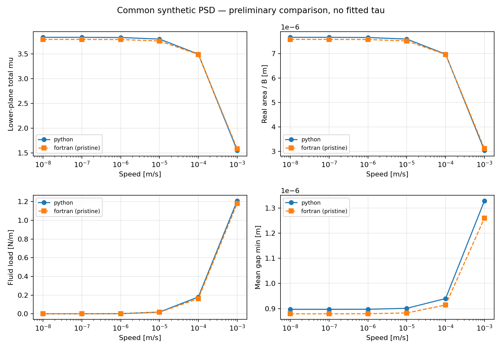
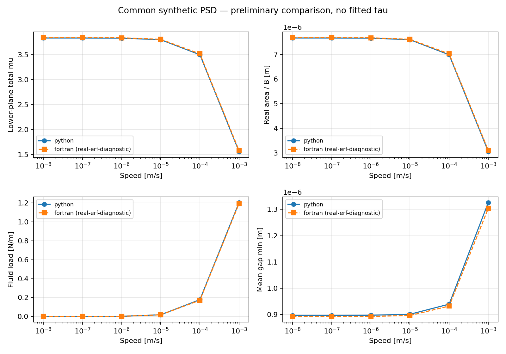

# 统一合成谱混合润滑核查记录 — 2026-11-18

本项目以符合物理理论、守恒和可验证的数值结果为目标，原版是参照，不要求复制其数值方法或缺陷。本报告区分未修改原版、诊断加速副本、Python 冻结版。**当前尚不能宣称已经完成全部物理和数值验证，也不能据此认定实验拟合有效。** 本次没有修改 `src/` 下的求解代码；云端运行的全部 Python 源文件与冻结 rc4 包逐字节一致。

共同输入、源码校验、运行方法、原生列序见项目中的 `benchmark/README.zh-CN.md`。参数为 E=3 MPa、ν=0.5、η=0.1 Pa·s、R=5 mm、W′=2 N/m、τ=1 MPa、上下壁无滑移、上圆柱粗糙、下平面运动、两端零表压；同一有限范围合成 PSD，hrms=1 μm，六个速度 1e-8 至 1e-3 m/s。本算例不拟合实验。

## 源码和运行身份

- Python 冻结提交：`026c8951add03e4440a55234849f236a1bf303a9`。
- Fortran 来自本对话最开始的 `AI.QQQ.ContactMechanics.11.09.2026.GNU.zip`，源文件为 `AI.ContactMechanics.14.09.2026.f90`，SHA256：`99d3b2e2c47a663ffe8b65bbdb7415db5eeebb434debd0ef404006600e861854`。
- GNU Fortran 14.2.0，选项与二进制校验值见 `provenance.json`。
- `fortran_erf_diagnostic_*` **不是未修改原版**：仅把实数 `DERF1(x)` 中经由复数 `CERROR` 计算 erf 的包装，替换成内建 `ERF(x)`，加速极慢的 BoF 预计算；控制方程、松弛和宏观求解未改。是否可用于辅助细化，须以未修改源码的同条件输出核对为依据。

首次未修改原版预检使用 Nx=129、从 1e-5 m/s 开始，在第一点发生 `ERROR.renormalization.factor.negative` 并 STOP。返回码虽为 0，但没有有效混合润滑输出。其极窄初始 Hertz 区没有落在任何节点上。后续候选改为 Nx=128、包含 x=0，并从 1e-8 m/s 开始。失败记录不能算作成功验证。

**最终取得了未修改原版的六点主结果。** 进程正常结束，六行前 8 列均有限，没有有内容的 ERROR 文件；同时仍有下文列出的辅助输出缺陷和浮点异常标志。与同条件 ERF 诊断副本比较，压力流动表逐字节相同，六行前 8 列在原版打印精度下完全相同。该核查支持在本基准中使用诊断副本作辅助细化；不代表其他工况或全部内部浮点数逐位相等。

未修改原版与粗网格 Python 的总 μ 最大相差约 **2.00%**，原生等效面积最大相差约 2.28%，有效剖面最小平均间隙最大相差约 5.46%，流体承载最大相差约 10.8%。这些粗网格差异通过后续细化明显缩小，但未达到完整收敛认证。

未修改原版的原始主表及迭代记录在 `fortran_pristine`，逐点对照见 `pristine_comparison/comparison.xlsx`。原生缺陷与主结果分开记录。

## 同一有限区间的诊断比较

初始区间为 ±12aH。粗网格：Python 129 单元、41 个输运基点；Fortran Nx=128、12 个压力点；谱对数步长 0.1。细化：Python 257 单元、81 个输运基点、1001 个接触表点；Fortran Nx=256、40 个压力点；两者谱步长改为 0.03。细化结果的 Fortran 目前属于**明确标注的 ERF 诊断副本**。

细化后的运动下平面阻力系数如下，保留分量的符号后相加：

| v [m/s] | Fortran ERF 诊断 | Python | 相对差 |
|---|---:|---:|---:|
| 1e-8 | 3.83900 | 3.83223 | −0.176% |
| 1e-7 | 3.83901 | 3.83191 | −0.185% |
| 1e-6 | 3.83605 | 3.82876 | −0.190% |
| 1e-5 | 3.80551 | 3.79740 | −0.213% |
| 1e-4 | 3.51478 | 3.49669 | −0.515% |
| 1e-3 | 1.57655 | 1.55718 | −1.229% |

这里 μ 大于 1，是公开指定 τ=1 MPa 和很低基准载荷产生的测试结果，不是对实验的拟合值。细化比较中，原生等效真实面积的差异约 0.2%–1.5%，有效剖面的最小平均间隙差异约 0.5%–1.7%，流体承载差异约 0.9%–3.7%。这些量的定义和原版导出缺陷均需明确。

Excel 和逐点数据在 `diagnostic_comparison_refined/comparison.xlsx` / `.json`。粗网格结果单列在 `diagnostic_comparison`。这些数值不能替代网格与计算区间收敛检查。

## 一个已定位的摩擦差异：空化区剪切

细化后滑动黏性剪切贡献相差约 17%–20%，明显大于总 μ 的差异。原版在 `pf−pa <= pcavity+1e-7 Pa` 时将该项设为 0；Python 则以液体饱和度 θ 乘滑动牵引，在空化区仍保留剩余液体的作用。这是两版已知的闭合假设差异。

在**同一份 Python 解的后处理**中，仅统计正压力区的滑动剪切，和诊断 Fortran 的差异缩小到约 0.1%–3%。见 `cavitation_sliding_audit.csv`。这一步没有重新求解，也没有在生产程序中关闭空化区剪切。它支持“空化区剪切规则是主要差别之一”，不代表余下差异已全部解释，也不能据此判定哪种规则一定适合实验。

另外，原版固体摩擦用平均接触压力估算面积，Python 对局部面积积分；原版还强制逆间隙因子不低于 1/h，Python 保留自己的显式截断和远间隙处理。这些也不是逐行复现。

## 网格与区间敏感性

Python 从粗到细，总 μ 最大变化约 0.46%，真实面积约 0.48%，最小间隙约 0.21%，流体承载约 1.24%。再将区间从 ±12aH 扩大到 ±24aH，使用 513 单元维持相近空间分辨率，总 μ 最大又变化约 **3.15%**，真实面积约 3.27%，流体承载约 2.59%，最小间隙约 1.16%。

因此目前只能讨论**同一有限区间内**的程序差异，不能宣称远场区间已收敛。候选输入中放宽的边缘压力诊断门槛 0.005 已公开记录；扩大区间后用回默认 1e-4，最大边缘压力比约 4.39e-6，但边缘压力较小仍不足以单独证明结果对区间不敏感。原始数据见 `python_sensitivity.csv` 和三个 Python 目录。

## 原版输出的独立问题

1. 冗长文件名中有列序错位：LOW/WITH 文件实际从 v 开始，共 16 列，没有 time。前 8 列可用于此次下平面比较，不能按文件名错位读取。
2. 空间导出和 hmin 搜索遍历 `2*Nx+1`，低速计算本体只填充前 Nx 个值，导致域外未计算值可能被读到。原生 hmin 因此报告 0。本报告从每个速度的前 Nx 个有效物理剖面重算 hmin，并在 Excel 中保留原生 0，不篡改源输出。
3. 部分上圆柱斜面受力辅助列为 NaN。低速阶段计算这些形状时使用了尚未由高速分支设置的量；本报告不将这些列视为有效受力。LOW 文件前 8 列有限不意味着全部 16 列都正确。
4. 原版报告了 IEEE_INVALID、DIVIDE_BY_ZERO、UNDERFLOW、DENORMAL 标志。结合上述问题，不能把“进程结束”当作全输出验证通过。

原版文件在报告包中使用短文件名，以免 Windows 解压时遇到路径过长；`native_filename_map.json` 保存原始文件名和原文件 SHA256。没有修补原始 Fortran 数值或导出代码。

## 低速到高速的补充诊断

六点主基准最后仍约有 40% 固体承载，没有覆盖完整的高速算法。另做七点扩展到 1e-2 m/s，并将原版算法切换阈值从 0.4 调至 0.5，让最后一点进入其另一分支；见 `high_speed_diagnostic_only`。这项是 ERF 副本的诊断，**尚未有未修改源码的高速锚点**。

最后一点的原版报告总承载约 2.0182 N/m，对目标 2 N/m 偏差约 0.91%；不能作为通过标准。Python 对应点的载荷残差约机器精度。原版与 Python 的总 μ 约 0.05613 和 0.06696，这个差别需在原版载荷/迭代收敛及高速分支单独核查后再解释，不应直接归因于物理理论。

当前结论：已形成可复跑的统一输入和分量对照，发现了具体数值与导出问题；这还不是完整理论验证的终点。对用户实验的大幅失配，仍须用实际表面和实验工况继续核查，不能仅凭本合成基准的接近结果将拟合出的 τ 当作已确认的界面属性。
