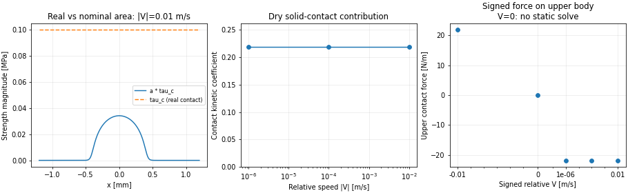

# 模块 5：真实接触面积上的固体滑动摩擦

2026-10-30。在 `53ab474` 的宏观干接触基础上，增加固体接触滑动摩擦。日常默认是实验给定的常数界面剪切强度；速度相关扩展采用用户确认的 log10(|V|) 高斯形式。没有预设压力或温度经验关系。

**实验剪切强度没有由用户提供，日常参数仍为必填的 None。本报告的 100000 Pa 仅是数值验证用的演示值，下面的摩擦力和系数不是材料实验结果。**



图中区分真实接触区的剪切强度 τc 与名义面积上的 aτc；零速度点仅表示未施加滑动摩擦项，不能用它推断静摩擦。报告图是70 dpi预览，程序日常输出170 dpi图像。

## 常数模型与面积、单位

剪切强度 τc 的单位为 Pa，作用在真实接触面积上。宏观接触结果给出每个单元的面积比 a_i，直接得到名义面积牵引：

\[
t_{upper,i}=-\mathrm{sign}(V)a_i\tau_{c,i},\qquad
V=U_{upper}-U_{lower},\qquad t_{lower}=-t_{upper}.
\]

采用原压力单元的宽度 Δx_i 做守恒积分，不对单元中心再做梯形积分：

\[
F_c'=\sum_i a_i\tau_{c,i}\Delta x_i,\qquad
W'=\sum_i p_{c,i}\Delta x_i,\qquad
\mu_c=F_c'/W',\qquad
P'=F_c'|V|.
\]

F' 和 W' 为 N/m；P' 为 W/m。给定横向宽度 B 后，总力为 BF'、总功率为 BP'，真实接触面积为 `B * sum(a_i Δx_i)`。B 留空时只输出每单位宽度的结果和系数，总力字段留空。圆柱横向长度或密封周长 B 与圆柱截面曲率半径是不同参数。

此阶段法向载荷全部由干接触承担，μc 的分母是干态 W'。以后混合润滑的全局摩擦系数应以总法向载荷归一化，不能直接拼接不同分母的系数。常数 τc 时，摩擦系数由真实面积与载荷决定；本阶段固定弹性法向状态下，对所有非零相对速度得到相同幅值。

V=0 时：滑动牵引、滑动摩擦力和耗散为零，`kinetic_contact_friction_coefficient` 与 `static_friction_limit_n_m` 留空，状态为 `no_relative_sliding_static_unmodelled`。不将滑动剪切强度当作静摩擦极限，不用任意速度阈值抹掉微小但非零的滑动。

## 日常参数与开关

先在 parameters.py 的 CASE.contact_friction 中填写实验值：

```python
'model': 'constant_shear_strength',
'model_parameters': {
    'constant_shear_strength': {
        'shear_strength_pa': None,  # 将None替换为实验剪切强度，单位Pa
    },
    # 其他模型的参数在文件内完整列出，只读取当前选中块
},
'relative_velocities_m_s': [0., 1e-6, 1e-4, 1e-2, -1e-2],
'temperature_k': 298.15,          # 传给模型；常数模型不依赖温度
'transverse_width_m': None,        # 可选真实横向宽度B，单位m
```

填写真实横向宽度（m）后才输出总力 N。此参数不控制法向几何和线载荷。

main.py 中：

```python
RUN_CONTACT_FRICTION = True
RUN_LEAKAGE = False
RUN_MIXED_FRICTION = False
COMPUTE_PRESSURE_FLOW = False
COMPUTE_SHEAR_FLOW = False
```

RUN_MACRO_CONTACT 可以保持 False：摩擦任务会自动调用宏观干接触和必要的 Persson 数据库，法向解只计算一次，各速度复用。RUN_CONTACT 不需要强制开启。输出目录换为新目录，例如 `results/contact_friction`。实验强度未填或组合不受支持时，在写结果前报错。

该开关是**固体接触摩擦**，没有启用完整混合摩擦。原 RUN_MIXED_FRICTION 仍为未实现入口，不能用它代替。

## 留给后续研究的接口

`contact_friction.py` 独立定义剪切强度规律与面积积分；`contact_friction_output.py` 负责参数、速度扫描和输出。可以替换强度模型而不修改法向求解器。

可选 `gaussian_log_velocity`：

\[
\tau_c(V)=\tau_b+\tau_a\exp\left[-\frac12
\left(\frac{\log_{10}(|V|/V_{peak})}{s_{dec}}\right)^2\right].
\]

参数是 baseline_pa、amplitude_pa、peak_velocity_m_s 和 width_decades。宽度的单位是十进制数量级；峰值速度必须为正。V→0 的幅值极限为 baseline_pa，但 V=0 仍不计算静摩擦。这个备选模型已有数值检查，日常默认仍为常数，未用它拟合实验。

更一般的关系选择 `custom`，由配置指定一个 Python 文件和函数：

```python
'custom': {
    'module_file': 'examples/contact_shear_model.py',
    'function': 'shear_strength',
    'parameters': {'shear_strength_pa': None},
}
```

函数接口为 `shear_strength(state, parameters)`，返回非负有限的强度幅值（Pa），可为标量或每个接触单元一个值。state 提供位置、带符号相对速度、温度 K、名义接触压力 pc、接触区平均压力 pc/a、真实面积比和平均间隙。它只在 a>0 的单元调用，不用任意小面积代替零面积。pc/a 是接触斑块内的平均压力，不是微观每一点压力，也不是流体绝对压力。

压力和温度只作为可用状态传递，不预设它们对 τc 的影响。可直接用 Python 编写任意研究关系；不用字符串 eval。被选中的用户源文件会执行，诊断记录文件与 SHA-256，并确保执行的正是被记录的源码。示例回调只复现给定常数，供用户替换。旧的未选中预设不读取。

## 输出

| 文件 | 内容 |
| --- | --- |
| contact_friction_cases.csv | 速度、真实面积、线载荷、摩擦力幅值与两侧有符号力、动摩擦系数、耗散，及可选总力 |
| contact_friction_profile_*.csv | 位置、面积比、两种接触压力、强度、名义牵引、温度和局部耗散 |
| contact_friction_diagnostics.json | 模型、方向、静止规则、单位、范围和自定义源码哈希 |
| contact_friction.png | 强度与名义牵引、系数随速度、上侧有符号摩擦力 |
| macro_geometry.csv 等 | 同一次法向解的形变几何、压力及其原有诊断 |

正速度使上侧受到负 x 方向摩擦，两侧力等大反向；总耗散非负。真实强度在无接触单元的输出为零占位，不能将其解读为在那里计算出了材料强度。无真实接触时力为零，系数不定义。

## 验证结果与演示

135 项回归测试通过；另有 13 项独立检查通过，见 [verification.json](verification.json) 与 [summary.json](summary.json)。包括：

- 非均匀单元上 `F'=τc A_real'` 的解析积分与 N/m、N、W/m、W 换算；
- 相对速度反向、两侧作用反作用、共同速度平移和非负耗散；
- 零速度规则、无接触状态以及错误输入拒绝；
- log10 速度高斯的峰值和对称数量级，以及压力／温度回调的解析积分检查；
- 速度扫描复用法向解，摩擦开关前后 `macro_geometry.csv` 逐字节一致；
- 宏观空间网格加密、横向宽度线性换算和下载源码 main 入口。

演示延用 E=3 MPa、ν=0.5、R=5 mm、线载荷100 N/m、仓库PSD；**演示 τc=100000 Pa、B=0.01 m 均是指定的验证输入，不是用户实验数据**。非零速度下：

| 量 | 演示结果 |
| --- | ---: |
| 真实面积／横向宽度 | 2.1853305e-4 m |
| 固体接触摩擦力／宽度 | 21.853305 N/m |
| 固体接触动摩擦系数 | 0.21853305 |
| 总法向力 | 1 N |
| 总摩擦力幅值 | 0.21853305 N |

257→513 单元，系数变化约0.000120%。法向网格和查表精度、材料模型误差、实验强度不确定性仍是不同来源；简单面积积分精确不代表材料摩擦已经校准。

数据见 [演示工况](example_cases.csv)、[演示牵引分布](example_profile.csv)、[模型诊断](example_diagnostics.json)、[网格检查](spatial_convergence.csv)、[宽度换算](width_scaling.csv)、[速度扫描](velocity_sweep.csv)。

独立复现无需原 Fortran 包：

```bash
python scripts/validate_contact_friction.py --output /tmp/contact_friction_validation
PYTHONPATH=src python -m unittest discover -s tests -v
```

本次完成的是弹性干态真实接触上的界面滑动摩擦；流体摩擦、橡胶黏弹性滞后摩擦、静摩擦／局部黏着、切向变形和摩擦生热反馈仍待后续模块。
