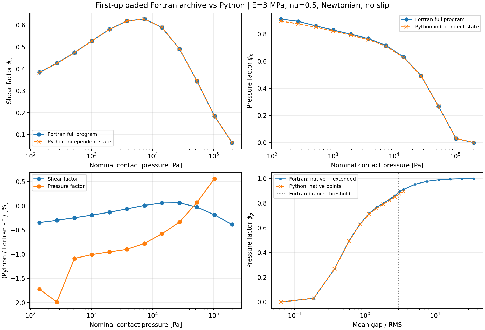

# 首个上传 Fortran 压缩包：完整流动／剪切因子对照

2026-10-30。Python 基线为 `cf52c2beb6f8c6dd57e6016f29fc4d5d8e39eab6`，包含 `3caf351`。本次只增加复核脚本和结果，没有修改生产计算模块。

在这组参数与节点上，剪切因子没有发现明显公式异常；压力因子存在最大约 1.99% 的差异，需要保留并解释，不能称为逐点完全一致。



## 使用的原始包与运行方式

使用本对话最开始上传的 `AI.QQQ.ContactMechanics.11.09.2026.GNU.zip`，不是后来泄漏复算用的 2025 年源码。重新提取包内 `AI.ContactMechanics.14.09.2026.f90`，实际编译执行完整主程序，经过 PSD、接触、间隙、PDF／渐近导流和流动因子流程；没有用单独提取的剪切公式代替完整程序运行。

| 对象 | SHA-256 |
| --- | --- |
| 首个 ZIP | `ae0dfddc8a5b8a8e5058d8cbe74f67fd00102bc76df42f6c734bfd41cea2b968` |
| 包内未修改源码 | `99d3b2e2c47a663ffe8b65bbdb7415db5eeebb434debd0ef404006600e861854` |
| 仓库 PSD | `c5e41d8e8b1bd8f15b222620794c4a3268cafdc52a21ffae4cb3579967c0e884` |
| 主对照编译源码（下面两处显式修改） | `784f470f15e7a7031c00c62271c7f958b8a8464d91c42c6473aed039a52856e9` |

原 `DERF1` 调用复数 `CERROR`，实数计算很慢。为取得完整曲线，主对照版本只对实数 `DERF1(x)` 使用编译器内置 `ERF(x)`，并修正最终诊断输出中 `LowPressure` 的格式类型错误：`WRITE(555,8276) DBLE(LowPressure)`。精确改动、输入和编译哈希见 [provenance.json](provenance.json)。没有改接触、PDF、有效介质、剪切插值或渐近拼接公式。

同时实际运行了**源码完全未修改的完整主程序**：100000 Pa、对数步长 0.03、PDF 输入 nurange=128（内部 512 点）。耗时 869.36 秒，已经生成完整一行因子表，随后在最终参数打印阶段以代码 2 退出：整数 `LowPressure` 被交给实数 `E11.4` 格式。运行日志见 [original_anchor_run.log](original_anchor_run.log)。相同输入下加速并修正打印的版本正常退出，耗时 29.34 秒；两份因子表**逐字节一致**：

| p（Pa） | 平均间隙（m） | φp | φs |
| ---: | ---: | ---: | ---: |
| 100000 | 2.75403e-7 | 0.0400586 | 0.192096 |

[未修改原版输出](pristine_coarse_anchor.txt) / [加速版输出](real_erf_print_coarse_anchor.txt)。这是一个完整程序锚点，不能据此宣称所有输入下 ERF 替换都已得到独立验证。

主对照另运行过仅加速、未修正打印的版本：它同样算完全部 18 行后打印报错。修正打印后重新运行，正常退出（244.07 秒），两次完整因子表也逐字节一致。原版其他耗时过长的尝试已终止，未纳入结果，退出状态完整记录在 provenance 中。

## 本次参数

这是当前剪切模块的独立验证例，不是先前 E=1.8 MPa、入口 0.414 MPa 的 FEM 密封泄漏复算。

- E=3 MPa，ν=0.5，E*=4 MPa；常数牛顿黏度 0.1 Pa·s，无滑移。
- PSD 使用仓库 `examples/data/roughness_psd.dat`；不做多项式平滑；能量修正 γ=0.4。
- 原版 `iflag015=1`，内部启用 `iflag008=2`：12 个原生接触压力点，约 140.15–200000.05 Pa，另加 6 个大间隙渐近延伸点，总计 18 行。
- `IN.FLOWFACTORS`：NvF=2，vmax=0.01 m/s，vmin=0.001 m/s，NpF=12，pmaxF=200000 Pa，Npadd=6，addp=1。
- 对数步长 0.01，PDF nurange=512（内部 2048 点），反馈 0.9，迭代 6000；原渐近分界 h/RMS=3，连续性修正开启。
- Python 独立计算相同物理参数，在原版列表精度的真实压力节点计算，采用现有默认 n_q=256；并非把原版间隙作为 Python 主计算输入。原源码网格使用单精度常量，所以末节点略偏离 200000 Pa。
- GNU Fortran 14.2.0，编译选项 `-mcmodel=large -ffree-line-length-none -std=legacy -fallow-argument-mismatch -O3`。

## 定量结果与差异来源

以下最大相对差只覆盖 12 个原生节点。相对差以 Fortran 为分母，压力因子近零节点不作相对误差统计；6 个延伸节点仅展示原曲线，不冒充额外独立验证点。

| 比较项 | 最大绝对相对差 |
| --- | ---: |
| 独立平均间隙 | 0.4275% |
| 独立剪切因子 φs | 0.3855% |
| 使用相同 Fortran h、RMS、hc 后的 φs | 0.0002133% |
| 独立压力因子 φp | 1.9865% |
| 直接 PDF 分支几何导流系数 K，相对原版拼接前值 | 0.006795% |

Fortran RMS=1.409876079 μm，Python RMS=1.409922364 μm；渗流间隙分别为 0.092123071 μm 和 0.091773508 μm。原版 RMS 用实际右端点 q 网格和源代码的 π 常量重建；高精度间隙用列表输出的 h/RMS 重建，避免主因子表的六位打印精度影响归因。

剪切插值为 `Ls = h / [1 + 2h max(h−hc,0)/(3 RMS²)]`，`φs = Ls/RMS`。共用同一状态后误差接近原表打印精度，说明本次端到端剪切差异主要来自上游间隙、RMS 和 hc。原版还使用 `h−hc<1e−10 m` 截断规则，Python 的规则不同；这组对照不能覆盖所有截断附近状态。

压力因子 `φp=K/h³`：约 0.4% 的间隙差会经三次方归一化放大。原版另外有大间隙渐近公式及连续性拼接，而当前 Python 使用直接 PDF 有效介质流程。这两部分共同解释压力因子差异；不能只归因于其中一项。两个低压原生点位于原版渐近分支，直接 PDF 分支的 K 则吻合得很好。200000 Pa 节点两者最终压力因子均为零，堵塞趋势一致。

完整逐点值见 [comparison.csv](comparison.csv)，原 18 行输出见 [fortran_flow_factors.txt](fortran_flow_factors.txt)，汇总见 [comparison.json](comparison.json)。这里没有验证完整运动混合润滑的空间压力求解，也没有验证全部摩擦因子或进行实验校准。未为追平这 1.99% 而改写现有 Python 算法；后续若要求忠实复刻原版，应单独处理原版间隙积分及渐近／连续拼接，并保留当前结果作为回归基准。

## 复现

在仓库根目录执行；首次运行目录必须不存在。原 ZIP 由用户自行提供，未将整包源码重新上传到仓库。

```bash
python scripts/run_fortran_flow_reference.py \
  --archive /path/to/AI.QQQ.ContactMechanics.11.09.2026.GNU.zip \
  --psd examples/data/roughness_psd.dat \
  --output /tmp/flow_reference \
  --compiler gfortran --real-erf --fix-diagnostic-print
python scripts/compare_full_fortran_flow.py \
  --reference-dir /tmp/flow_reference --output /tmp/flow_comparison
```

去掉 `--real-erf` 使用未加速实数路径；去掉 `--fix-diagnostic-print` 保留原诊断打印错误。未修改原版锚点的控制为：`--anchor-pressure-pa 100000 --step 0.03 --pdf-points 128`，不加上述两个修改选项。原版耗时可能较长；`--timeout` 可调整。`--prepare-only` 只提取输入并记录修改，不编译运行。

检查了新脚本语法和参数入口；`--prepare-only` 生成的全部输入哈希、主对照编译源码哈希与本次实际运行一致；比较脚本已实际读取正常完成的原程序输出，独立运行 Python 得到本报告。原版锚点和修正前后表格的一致性直接比较文件字节。没有用先前的三行剪切内核测试替代本次完整程序对照。
