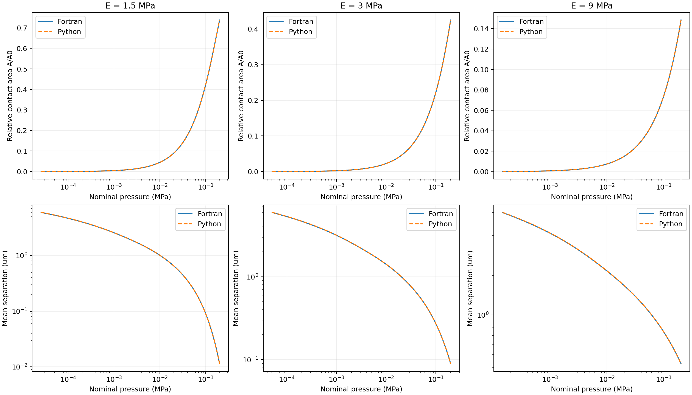
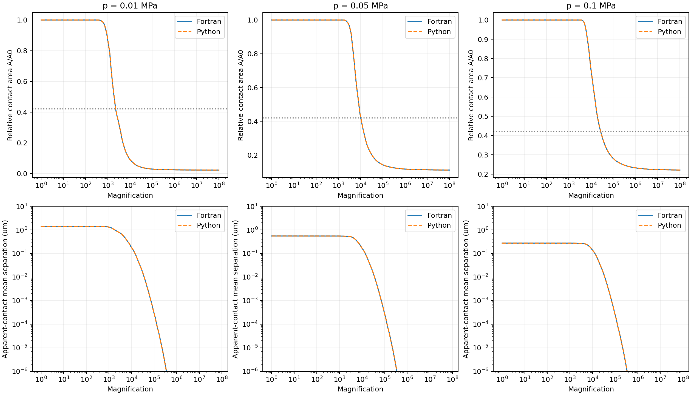
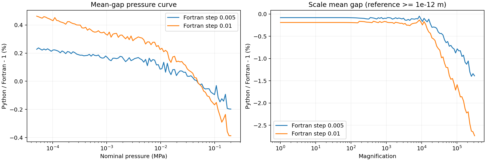
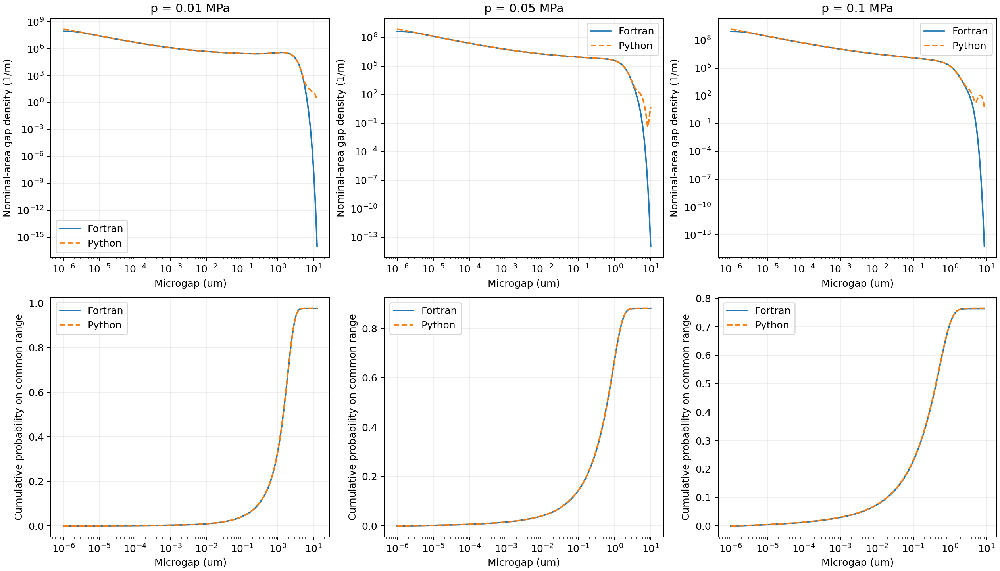

# Python 与 Fortran 弹性干接触对照

## 结论

**在本次 PSD 和弹性参数范围内，relative contact area 与平均分离量的压力曲线接近，可作为已验证的弹性基础基线；不能据此把包括完整间隙分布在内的整个模块宣布结束。**

主要结果：

- 三组材料的面积—压力曲线最大相对差不超过 **0.065%**；平均分离量—压力曲线不超过 **0.603%**。
- 有临界倍率的八组主工况，原生近似阈值选择下 uc 差异不超过 **1.724%**；一组两边都没有跨过 A/A0=0.42。
- 共同间隙范围的累计概率曲线最大绝对差为 **0.002764**，约0.2764个百分点；共同范围的第一矩最大相对差约 **2.158%**。
- **原生完整第一矩最大相对差为9.521%**。两边的截断、尾部和分布离散并不相同，且各自 PDF 第一矩也不严格等于能量公式的平均间隙。因此完整 PDF 尚未达到可关闭该部分工作的状态。

本轮没有修改 Python 物理计算公式、拟合参数或强行归一化曲线。后续应先明确分布的积分域/截断约定，再验证泄漏、混合摩擦实际需要的分布积分。

## 输入与运行范围

| 参数 | 取值 |
| --- | --- |
| Young's modulus E | 1.5、3、9 MPa |
| Poisson ratio | 0.5 |
| 有效模量 E*=E/(1−nu²) | 2、4、12 MPa |
| 指定 nominal pressure | 0.01、0.05、0.1 MPa |
| 能量修正 gamma / afact | 0.4 / 1 |
| PSD | 用户提供的 block PSD；二维各向同性，q为m⁻¹、C为m⁴ |
| q0 / q1 | 10 / 1e9 m⁻¹，保留原有外推尾点 |
| PSD 处理 | scaleC=1、log–log线性插值、关闭多项式平滑 |
| 主倍率步长 | Fortran delzeta=0.01 |
| 加密检查 | E=3 MPa、p=0.1 MPa，delzeta=0.005 |
| Python | 当前库，n_q=256；临界面积容差0.005 |

原包默认 `npolyCq=6` 会平滑 PSD。本次在输入工作副本中改为0，确保双方使用相同的原始数值谱；原上传文件和归档源码未覆盖。

完成 **14个批量参考运行及1个独立原版运行**。批量包括三组 E 的 `iflag003=2` 压力扫描、九组 E/p 的 `iflag003=3` 倍率与PDF计算，以及两个0.005步长检查。全部具有正常退出和有效数值输出。

一个额外的0.0025步长试算因计算量呈立方增长、且已定位的原生PDF差异不能靠网格加密消除而主动停止；它**没有计入成功数或比较结论**，原因与状态保留在 comparison.json 的 excluded_runs 中。

这不是黏弹性、分层、黏附、泄漏率、混合摩擦或实验准确性的验证，也不代表所有其他PSD和参数都已验证。

## 原版与批量加速副本

完全未改源码的 E=3 MPa、p=0.1 MPa、iflag003=3 基准运行已完成，实际运行约 **685秒**。源码原始/编译后哈希一致，原版没有使用实数erf替换。

批量副本仅做两种记录在案的改动：

1. 将实数 `DERF1` 对复误差函数 `CERROR` 的包装替换为 GNU intrinsic `ERF`。先前100001点、[0,10]区间比较最大绝对差约4.9e-15。
2. 将PDF输出从每100点一行改为每点一行，保留全部40000个内部采样点；不改变概率计算。

实际源文件差异见 [source_changes.diff](source_changes.diff)，完整编译/输入/输出哈希保存在 [comparison.json](comparison.json) 的 provenance 中。

原版与加速副本对照：1000行面积扫描、1842行倍率面积/平均间隙、528行u1数据和汇总量的打印数值**全部相同**。401个对应PDF输出点的最大相对密度差约 **6.44e-12**。这支持本次批量加速在所测锚点下的数值等价性；不将它称为每组都运行了完全未改源码。

## 整条压力曲线

每组 h(p) 和配套面积曲线比较108个实际输出压力节点，另检查1000点面积扫描。Python在Fortran实际输出的同一压力点求值，未通过重标定或移动压力轴对齐。与新程序默认110点扫描的节点分布不必相同。

| E (MPa) | E* (MPa) | 配套 relative contact area 最大相对差 | mean gap 最大相对差 |
| --- | --- | --- | --- |
| 1.5 | 2 | 0.0498% | 0.6025% |
| 3 | 4 | 0.0648% | 0.4625% |
| 9 | 12 | 0.0542% | 0.4698% |



Fortran采用ln(q)右端矩形积分，并将最高q截断到整步数；Python采用分段精确谱矩及分段高斯积分。Fortran部分输出仅有约四位有效数字，误差不能解释为纯算法差异。

## 倍率曲线、u1 与临界查询

对九组主工况的A(zeta)/A0全部1842个输出点进行面积比较。平均间隙曲线每组取180个源节点独立复算；相对误差只在参考间隙不小于1e-12 m的点统计，另保留绝对误差。

0.01步长下，倍率平均间隙最大相对差约2.83%，主要涉及小间隙尺度；在 E=3 MPa、p=0.1 MPa 的加密例中，从约2.734%降到1.400%。该例h(p)最大相对差同时由0.4625%降到0.2371%。这支持离散误差随加密减小，但并不是零误差或任意精度保证。





uc采用各程序原生网格中接近A/A0=0.42的u1比较，双方选到的实际面积比可能略有不同。因此 [critical_summary.csv](critical_summary.csv) 同时保留两边实际面积比和倍率，不只给出uc误差。

主工况的有效uc最大相对差1.724%。E=3 MPa、p=0.1 MPa时，Fortran0.01步长uc约0.1249 μm、Python约0.124276 μm；将Fortran步长改为0.005后约0.1243 μm，相对差约0.0197%。E=1.5 MPa、p=0.1 MPa时，最高倍率的面积比仍高于0.42，双方均未找到临界倍率。

这里验证了临界查询及相关尺度响应，**未宣称Python已经输出并逐点验证完整u1(zeta)曲线**。

## 间隙分布：接近的部分与未统一的部分

双方均比较名义面积加权的连续密度，而非将它们各自归一到1。Fortran全部40000点用于积分；图和CSV为便于阅读才在积分之后抽样。



共同范围指每个Fortran算例实际输出的下、上间隙界限。Fortran累计概率从该下限开始积分，Python用解析CDF差计算同一区间的概率；第一矩还用CDF分部积分交叉检查，避免近零尖峰造成密度采样积分失真。

共同区间CDF最大绝对差0.002764；共同区间第一矩最大相对差2.158%。但二者原生分布存在不同截断：Fortran使用A>0.999等倍率截断、u1min=1e-12 m及有限输出上限；Python的有限体积混合和完整正间隙尾部不同，并单独报告未解析质量。

差异最大的 E=1.5 MPa、p=0.1 MPa 算例：

| 量 | Fortran | Python |
| --- | --- | --- |
| 能量平均间隙 (μm) | 0.08957594 | 0.08923353 |
| 原生PDF第一矩 (μm) | 0.08664878 | 0.09489819 |
| PDF第一矩相对自身能量间隙 | −3.268% | +6.348% |

两程序原生第一矩差9.521%；若只取共同间隙范围，第一矩差约2.158%。Python第一矩中约0.006379 μm来自共同范围之外。因此不能把原生差异全归咎于网格，也不能因主峰或CDF看起来重合便宣布完整分布相同。

所有工况的质量、第一矩、覆盖区间和差异见 [pdf_summary.csv](pdf_summary.csv)。密度点值的相对误差在接近零的尾部可极大，故不拿它作为单一验收指标；没有删去这些点以制造一致性。

## 建议的阶段验收

可以暂时冻结本次验证范围内的弹性面积、平均间隙和近似临界查询接口，并继续开发应用接口。

完整分布应继续保留实验性状态。进入依赖P(u)积分的均质化流动和摩擦计算前，先选定/明确积分域和截断规则，并检查所需矩及概率质量；不能以强制归一化隐藏问题。这里证明的是代码间一致性的范围，不是Persson理论或实验结果的最终准确性。

## 复现

需要Python依赖、可用GNU Fortran编译器、用户原始ZIP和PSD；完整Fortran包不包含在Git仓库中。普通Python计算仍无需Fortran编译器。

```bash
python -m pip install -r requirements.txt
python -m pip install -e .
python scripts/run_fortran_reference.py --archive ORIGINAL.zip --psd examples/data/roughness_psd.dat --output results/pristine_anchor --compiler gfortran --mode 3 --delzeta 0.01 --timeout 3000
python scripts/benchmark_fortran_matrix.py --archive ORIGINAL.zip --psd examples/data/roughness_psd.dat --output results/matrix --compiler gfortran --jobs 2 --timeout 1200
python scripts/analyze_fortran_matrix.py --matrix results/matrix --psd examples/data/roughness_psd.dat --output results/comparison --anchor results/pristine_anchor
```

原版锚点可能耗时十几分钟。基准工具拒绝覆盖已有目录，检查退出状态和有效输出；未完成/失败的运行不参与比较。JSON记录了源码变体及哈希、输入哈希、每个比较量的定义和可复核数值。
