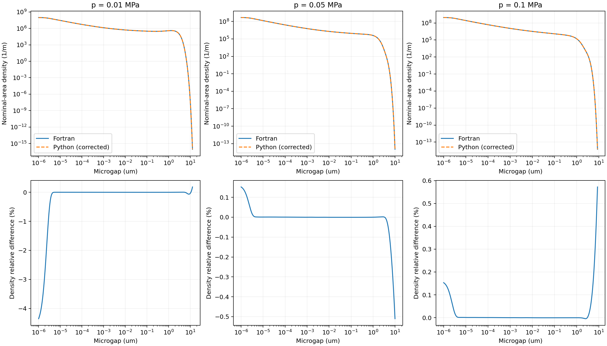

# 间隙分布尾部修复与复核

图中的异常长尾和孤立小峰已消失。修复后的 Python PDF 与原 Fortran method 1 在本次10组弹性工况下接近；不是逐位相等。原有接触面积、能量平均间隙及临界间隙算法未修改。



上排为 E=3 MPa、ν=0.5，p=0.01/0.05/0.1 MPa 的完整间隙曲线；下排明确展示剩余相对误差。微观间隙横轴为 μm，密度单位 1/m。图和CSV仅在积分完成后抽样；误差统计使用全部40000点。

## 原因

旧实现与原程序有三处实质差别：

1. **缺少近完全接触的尺度截断。** Fortran 排除 A/A0>0.999 的尺度，另以 A/A0<0.0001 和 u1<1e-12 m 结束积分。旧 Python 把这些尺度也纳入混合。在 A≈1 的边界，用体积差除以几乎为零的面积差会得到不适定的巨大 u1；对应概率虽然很小，却在大间隙处形成额外峰，并污染第一矩。例如旧 E=3 MPa、p=0.1 MPa 的一段面积差约4.9e-14，计算中心约1.03e4 m。这个极端中心在图的范围外，但同一组近完全接触尺度还有数 μm 至数十 μm 的中心，直接造成可见尾峰。
2. **u1 的导数与概率权重离散不同。** 旧实现使用有限体积比值；Fortran 在 ln(zeta) 网格上使用解析 A' 计算 u1，使用中心差分面积变化计算 PDF 权重。近边界时这些差别会明显放大。
3. **RMS 与尺度积分节点不同。** 旧实现使用平方对数节点和独立剩余谱矩积分；原程序使用统一对数节点和包含当前节点的右矩形谱积分。与源程序比较极低密度尾部时，这些差别不能忽略。

**0.999 是分布积分的上面积截断；0.42 是临界渗流面积，二者用途不同。** 修复作用于分布的尺度组成，不是把画出的曲线从某个间隙位置剪掉。

## 修改

PDF 现在采用原程序的 method 1 离散：

- ln(zeta) 默认步长0.01，与批量参考相同；0.005参考使用相同的0.005步长。
- u1 = ubar + A/A'_analytic × ubar'_centered；概率权重为 (A[k-1]−A[k+1])/2。
- 剩余 RMS 与平均间隙采用该尺度网格的包含当前节点的谱积分。每个下限独立累加，避免大谱矩相减丢失很小的剩余谱。
- 同步0.999、0.0001及u1min截断。所有截断参数都在 parameters.py 的 options 中。
- 保留准确的能量核积分，不照抄原程序近似查表的误差。接触面积和能量平均间隙仍使用原有独立积分。
- 不归一化密度、不缩放间隙、不把遗漏概率移入接触面积。遗漏概率和尺度积分误差分别输出。

现在 n_q 控制能量/临界间隙积分；pdf_log_step 单独控制 PDF 尺度网格。增加压力点数或输出间隙点数不能替代这个修复。

## 实际复核

复用此前已正常完成、具有输入/输出和源码哈希的 Fortran 参考计算，**本轮没有重新运行完整 Fortran**。三个杨氏模量 E=1.5/3/9 MPa，ν=0.5；三个名义压力 p=0.01/0.05/0.1 MPa；另有 E=3 MPa、p=0.1 MPa、步长0.005。此前完全未改源码的独立锚点已证明批量参考的误差函数加速和加密输出不改变接触曲线，详见[原始对照报告](../fortran_comparison/report.md)。

| E (MPa) | p (MPa) | ln(zeta)步长 | 大间隙尾部最大密度相对差 | 完整第一矩相对差的绝对值 | 共同区间CDF最大绝对差 |
| --- | --- | --- | --- | --- | --- |
| 1.5 | 0.1 | 0.01 | 1.8814% | 0.002388% | 3.35e-06 |
| 1.5 | 0.01 | 0.01 | 0.1898% | 0.000557% | 3.52e-06 |
| 1.5 | 0.05 | 0.01 | 0.5724% | 0.000435% | 1.75e-06 |
| 3 | 0.1 | 0.005 | 0.0294% | 0.000470% | 1.75e-06 |
| 3 | 0.1 | 0.01 | 0.5724% | 0.000435% | 1.75e-06 |
| 3 | 0.01 | 0.01 | 0.1830% | 0.000665% | 9.69e-06 |
| 3 | 0.05 | 0.01 | 0.5102% | 0.000164% | 1.79e-06 |
| 9 | 0.1 | 0.01 | 1.9575% | 0.000357% | 2.52e-06 |
| 9 | 0.01 | 0.01 | 0.9147% | 0.000709% | 5.71e-06 |
| 9 | 0.05 | 0.01 | 0.3996% | 0.000563% | 3.85e-06 |

“大间隙尾部”在脚本中明确为 u≥argmax[uP_Fortran(u)]。全区间最大密度相对差约4.3523%，发生于 E=3 MPa、p=0.01 MPa 的约1e-12 m**小间隙端**；大间隙尾部最大为1.9575%，不是4.3523%。例如你截图的 E=3 MPa 三个压力，大间隙尾部最大相对差分别约0.183%、0.510%、0.572%。

修复前原生完整第一矩差异最高9.521%；现在最高0.002389%。共同区间CDF最大绝对差由约0.002764降至9.694e-6。完整第一矩是 Python 解析高斯混合的全正半轴积分，与 Fortran 原生输出的数值第一矩比较；没有为了接近参考而裁成同一输出域。

**剩余误差定位：** 在 E=3 MPa、p=0.01 MPa，诊断性地仅将中心 u1 换成 Fortran 输出的完整精度 u1，保留 Python 的概率权重、RMS宽度和高斯求和，40000点最大密度相对差降至约1.14e-6。这将剩余差异定位在 u1 的数值生成，而非高斯密度公式。Fortran 使用 BoFold 的近似积分和 BoF 的插值表，Python 保留独立准确能量核；小间隙端及极低密度尾端会放大这些微小差别。此替换仅用于诊断，正式计算和回归测试都由 Python 自行生成 u1，不读取 Fortran 输出。

## 概率记账与适用范围

保持标准 Persson relative contact area a。尺度积分计算的非接触概率与准确谱矩得到的1-a有小的有符号差异，单独报告 quadrature_mass_error；没有把它藏在强制归一化中：

```
resolved_continuous_mass + unresolved_continuous_mass
  = (1 - relative_contact_area) + quadrature_mass_error
```

unresolved_continuous_mass 分为近完全接触截断、低面积截断、小u1截断及尺度边界缺口。高斯展宽和这些截断仍会使 PDF 第一矩不同于独立能量平均间隙；本次一致是对 Fortran 算法的复核，不是证明近似分布严格满足第一矩恒等式。流动、泄漏、混合摩擦及黏弹性没有因此自动通过验证。

## 代码与运行检查

- 41项单元和集成测试通过，含10组真实 Fortran PDF 参考采样、极低密度尾点、扩展间隙轴自然衰减、截断概率记账和旧接口运行。
- 4项参考输出解析/完整性自检通过。
- 默认真实 PSD、E*=4 MPa、gamma=0.4，10到200000 Pa的110点扫描已完成，生成110组PDF/分箱文件和图像；逐项检查分箱概率非负、概率合计及尺度误差记录。
- tests/data/fortran_gap_pdf.json 保留真实参考采样、PSD及来源输出哈希。comparison.json 保存逐工况指标、诊断性控制和来源记录；*.csv 保存绘图数据。

复核命令（原始参考输出需在本机另行准备）：

```bash
python -m unittest discover -s tests -v
python scripts/compare_fortran_reference.py --self-test
python scripts/verify_gap_tail.py --matrix results/benchmark_matrix/accelerated_v2 --psd examples/data/roughness_psd.dat --output results/new_gap_tail_check
```

日常运行仍是 python main.py；更新代码后使用新的 output_directory，避免与修复前结果混用。
