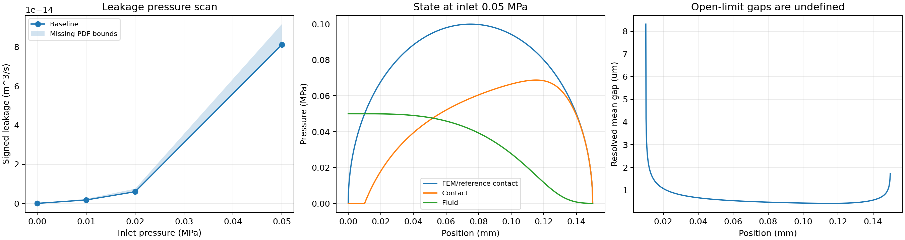
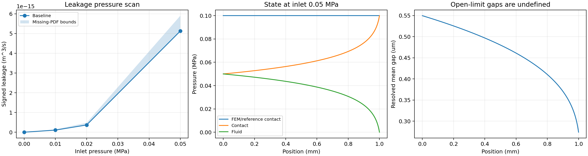
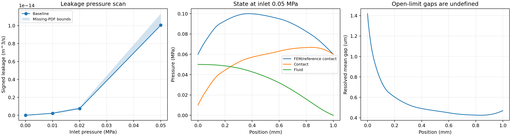
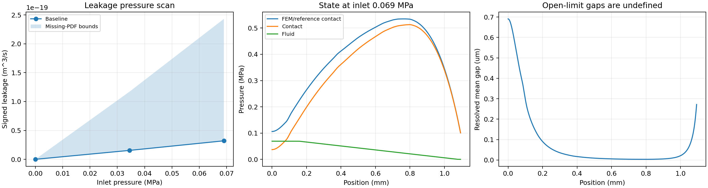

# 空间液体泄漏：参数、模型、验证

已实现给定压力曲线、O-ring Hertz分布、square-ring恒压分布，另提供Gaussian分布及固定接触选项。本报告保留液体验证记录；新增500气体估算与独立5000功能见[气体说明](../gas_leakage.md)。

## 最少操作

1. main.py 中 `RUN_LEAKAGE=True`，默认已开启。
2. 当前parameters.py按工况与数值设置整理：在CASE的leakage.geometry字典中选择type与对应几何参数，用inlet_pressures_pa设置入口压力列表；详见[参数说明](../parameters.md)。旧的geometry字符串与geometry_parameters预设写法继续兼容。
3. 运行 `python main.py`；结果默认 `results/leakage`。目录非空时请换 output_directory，程序拒绝混合新旧结果。

单个入口压力也可用 `inlet_pressure_pa`，与列表二选一。出口为 `outlet_pressure_pa`。所有压力共用同一参考零点，单位Pa；当前液体模型不作气体绝对压力换算。

## 三种几何

当前配置只展示正在使用的geometry字典，可用下列示例替换。旧的geometry字符串选择器与geometry_parameters同名分组写法仍可使用：

```python
# 1. 给定曲线
'geometry': {
    'type': 'prescribed_profile',
    'pressure_file': 'examples/data/seal_pressure_profile.csv',
    'file_format': 'csv',
    'profile_sampling': 'preserve',
    'interpolation': 'pchip',  # 或 linear
},

# 2. O-ring：按Hertz参考压力处理
'geometry': {
    'type': 'oring_hertz',
    'cross_section_diameter_m': 3e-3,
    'peak_pressure_pa': 1e5,
},

# 3. Square ring：恒定参考压力
'geometry': {
    'type': 'square_ring',
    'length_m': 1e-3,
    'reference_contact_pressure_pa': 1e5,
},
```

Hertz模式也可用 `length_m` 直接给接触带长度，代替截面直径，两者二选一。用直径D时，接触带长度 L=2 D p_peak/E*。D是O-ring截面直径，不是密封环整体直径。`seal_width_m` 为垂直流向的有效宽度，环形密封通常对应有效周长。

Hertz压力为 p_peak sqrt[1−(2x/L−1)²]，square-ring为常数。几何在流体压力扫描中保持参考状态；没有重新求解整个O-ring的结构变形。

CSV示例：

```csv
x_m,contact_pressure_pa,interface_reference_pressure_pa
0,60000,0
0.00005,72000,0
0.00016,90000,0
0.00037,100000,0
0.0006,95000,0
0.00083,80000,0
0.001,60000,0
```

第三列可省略，缺省为0。要求至少两个点，x严格递增，接触压力非负；使用真实坐标与单位，不猜测MPa或mm。示例为演示数据，不是FEM实验标定。

原始Fortran压力文件选 `file_format='fortran'`，读取名称、外部参考流体压力MPa、随后x[m]/接触压力MPa。数据自动转换为SI，文件哈希与参考加载工况记录在诊断中。

`profile_sampling='preserve'` 为默认。`legacy_uniform_zero_padding` 仅用于复现原程序的重新等距采样、补零端点规则；它会改变曲线的空间分布和长度，并明确记录。原Fortran读取坐标后重建位置的行为不会静默沿用。

## 其余常用参数

```python
'leakage': {
    'mode': 'spatial',
    'transport': 'liquid',
    'geometry': 'oring_hertz',
    'geometry_parameters': {
        'oring_hertz': {'cross_section_diameter_m':3e-3,'peak_pressure_pa':1e5},
        # 其余几何预设见 parameters.py
    },
    'seal_width_m': 1e-2,
    'inlet_pressures_pa': [0, 1e4, 2e4, 5e4],
    'outlet_pressure_pa': 0.,
    'coupling': 'local_unloading',   # 或 fixed_contact
    'conductance_model': 'effective_medium',  # 或 critical_junction
    'critical_alpha': 1.,
    'percolation_policy': 'legacy_spc_plateau', # 或 physical_zero
    'spc': .8,
    'database_interpolation': 'log_pchip', # linear用于原程序共享表对照
    'compute_upper_bound': True,
    'solver': {'nodes':201,'output_points':1001,'tolerance':1e-5,'max_nodes':20001},
}
```

黏度集中在 `interface.viscosity_pa_s`，默认0.1 Pa·s取原Fortran输入。接触、PDF和临界面积参数仍在原options；CJ沿用critical_area_tolerance，并用(alpha*uc)³作为几何导流系数。

与旧选项的关系：O-ring+卸载+EM对应5；square-ring+卸载+EM对应50；导入曲线+卸载+EM对应500。将EM换CJ分别对应4/40/400。固定接触Hertz/Gaussian提供6/7相应的参考几何处理。旧四字段的均匀固定接触泄漏接口继续兼容。新增 `fortran_mode=5000` 独立求解二次导流和分子通量；参数与验证范围见气体说明。

## FEM与局部卸载

参考总法向量定义为：

\[
T_{ref}(x)=p_{c,ref}(x)+p_{f,ref}(x),\qquad
p_c(x)=\max[T_{ref}(x)-p_f(x),0].
\]

FEM在入口侧/外侧已施加的载荷属于参考状态，**不会把文件头的外部流体压力再次加到界面压力上**。若FEM已经在某些接触界面位置施压，可在CSV第三列显式给出对应的p_f,ref；该部分按增量处理。

扫描入口压力时，外部FEM参考载荷与曲线保持固定。单条FEM曲线没有自动变成不同外部液压载荷下的一组曲线；要分析这些工况，应提供相应FEM参考状态。诊断始终记录此约定。

这实现原500类型的局部卸载近似，未引入非局部结构柔度、整体密封弯曲或新的FEM计算。

## 守恒求解与开口

液体通量每单位宽度J满足：

\[
\frac{dJ}{dx}=0,\qquad J=-\frac{K(p_c)}{12\eta}\frac{dp_f}{dx},\qquad Q=WJ.
\]

在每个空间面上按“压力降=恒定通量×面阻力”离散，联立内部压力和一个未知通量，采用稀疏Newton及线搜索求解。随后加密空间网格，默认检查Q变化不超过max(10*tolerance,1e-6)。nodes是初始均匀网格；给定曲线的真实坐标及局部极值也会加入求解网格，避免窄压力峰被跳过。之后逐区间二分加密。output_points控制基础导出采样数；输入坐标和极值也保留在完整输出中，因此实际导出点数可能更多。实际求解点数另输出。没有用固定次数的未收敛迭代作为结果。

pc>0但低于数据库下限时，采用有记录的匹配对数间隙、立方导流延拓；需要更精确低压响应时应扩展数据库。pc<=0采用零阻力的reservoir极限，平均间隙留空，不伪造有限开口高度。状态converged_open_limit标明存在这类点，最大开口超压也输出。整条密封完全开口时，缺少结构/几何开口信息，程序拒绝给有限泄漏率。

物理零导流下若存在无法被入口压力卸载的阻断区，Q=0，但区间内部压力可能不唯一；导出状态blocked_pressure_not_unique，未知压力留空。某些跨越阻断阈值的耦合工况需要额外开口/结构闭合，程序会明确报错。不会为通过求解偷偷加一个正导流下限。

## spc平台与PDF缺口

**legacy_spc_plateau会改变物理结论。** 它在spc×标准Persson渗流压力处读取导流系数，将更高接触压力的导流能力展平。当前在明确的压力位置插值，而原程序按其离散压力网格寻找节点；属于兼容该规则，并非逐位复刻其节点取整。

physical_zero不加平台。对你原包FEM曲线、入口69000 Pa：平台模型得到约3.2029e-20 m³/s，physical_zero判定Q=0。选择应依据研究模型；不能把平台产生的有限泄漏解释为严格渗流结论。

`leakage_transport_table.csv`同时保留raw和used K，避免把原始零导流表与实际平台计算混淆。PDF缺口的零/无限导流界限沿用模块4；上下界分别求解空间状态，并非对流量简单乘比例。该范围不包含FEM参考误差、局部卸载近似、spc模型误差或实验不确定性；CJ没有相同的PDF误差界。

## 输出

| 文件 | 内容 |
| --- | --- |
| leakage_cases.csv | 入口/出口、总泄漏率、缺口上下界、模型、状态、求解节点和守恒检查 |
| leakage_profile_000.csv等 | 对应入口工况的x、参考压力、流体压力、接触压力、间隙、relative contact area和近似标记 |
| leakage_transport_table.csv | 原始及实际使用的导流系数，显示平台处理 |
| leakage_diagnostics.json | 文件哈希、FEM参考工况、模型假设、数据库范围、求解选项 |
| leakage.png | 全部入口工况Q曲线；列表最后一个工况的空间压力和间隙，图中标注入口压力 |
| diagnostics.json | 全流程状态、参数快照、实际数据库扩展信息 |

数值失败时workflow_status标记leakage_failed或flow_failed，不以“已完成”掩盖局部文件。零压差精确给Q=0；反向压差给有符号反向流量。未表示的开口间隙与阻断区压力不会填为零。

## 实际验证

64项测试通过：平行板与非线性压力导流的独立解析解、三类几何、真实坐标/MPa换算、参考界面载荷、窄峰网格保留、阻断、开口标记、反向流动、旧入口及6组实际Fortran空间参考回归。

默认运行已实际完成：真实PSD、E*=4 MPa、gamma=.4，110个基础压力点加一个spc点，共111个数据库点；入口0/10/20/50 kPa。原包FEM曲线自动扩展到约540227 Pa，共122点，并完成0/34.5/69 kPa三个工况。有效介质和临界通道两种模型均已实际运行。

### 原Fortran空间核心对照

从用户原始版本（SHA256 99d3b2e2c47a663ffe8b65bbdb7415db5eeebb434debd0ef404006600e861854）的500例程抽取真实阻力积分、局部卸载更新及泄漏公式。提取的核心算术保持原样，输入相同参考曲线、相同导流表；原程序的压力连续扫描及端点离散保留。辅助驱动使用源程序已启用的线性插值模式。这里比较空间求解，不将共享的导流表冒充原程序全流程独立计算。

每组做(Nx,Npa)=(501,20000)、(1001,40000)、(2001,80000)，old=.9；6组共18次Fortran实际运行。表中差为Python/Fortran−1，最后列为空间压力最大绝对差Pa：

| 几何 | 入口Pa | 粗网格Q差 | 中网格Q差 | 细网格Q差 | 细网格压力差Pa |
| --- | --- | --- | --- | --- | --- |
| square | 10000 | -0.0756% | -0.0379% | -0.0190% | 9.18 |
| square | 50000 | 0.4035% | 0.1995% | 0.0991% | 379.66 |
| hertz | 10000 | 0.1623% | 0.0812% | 0.0406% | 6.58 |
| hertz | 50000 | 0.6524% | 0.3266% | 0.1638% | 31.79 |
| profile | 34500 | -0.0171% | 0.0120% | 0.0030% | 14.03 |
| profile | 69000 | -0.0122% | 0.0161% | 0.0049% | 30.93 |

最细网格最大Q差约0.164%。原程序端点在内部采样点施加压力，且每个压力步只做一次松弛更新；加密后差异总体下降。压力差最大约380 Pa，出现于50 kPa的square工况，其出口梯度很大；不能只报Q差就声称空间压力逐点相等。

原始输入读取、完整接触/导流数据库生成、气体附加输出以及所有iflag分支不属于本项空间核心验收。完整记录见[对照JSON](fortran_comparison.json)，[Fortran验证驱动](reference_500.f90)保留核心源片段；fixture含真实参考值和共享数据。

压力数据库另加对数中点：122点至229点（仅加密spc以下导流范围），实际重算每个新节点的PDF/导流能力。六工况Q最大变化约0.286%；原FEM两工况约0.0026%和0.0027%。见[压力网格检查](pressure_refinement.json)。压力节点数、PDF积分、空间网格是三种不同分辨率，不能只加密其中一种便宣称整体收敛。高精度研究建议增加contact_pressure.number_of_points并比较Q。

## 示例曲线

所有示例尺寸、黏度和压差仅用于运行及数值验证，不作为实验标定。

Hertz，D=3 mm、峰值0.1 MPa、流向长度0.15 mm、有效周向宽度10 mm：



[工况表](hertz/cases.csv)。入口10/20/50 kPa的Q约1.7530e-15、5.9541e-15、8.1199e-14 m³/s。开口极限点的间隙留空。

Square，流向长度1 mm、参考压力0.1 MPa：



[工况表](square/cases.csv)。

随程序附带的非均匀坐标CSV演示曲线：



[工况表](profile/cases.csv)。

原包FEM参考曲线，文件头外部流体参考压力69 kPa，坐标原样保留：



[工况表](provided_fem/cases.csv)。入口69 kPa的平台模型基线Q约3.2029e-20 m³/s，PDF缺口上界约2.4315e-19 m³/s；这一较宽范围说明模型误差仍可显著大于数值离散误差。原曲线扫描时外部FEM载荷固定在69 kPa，其他入口值不是重新计算的FEM加载状态。

各目录附最后工况的101点空间样本供看图；守恒和网格指标使用实际求解网格计算，不使用绘图抽样值。

## 模块归属与复现

profiles.py归模块1；core.py提供模块2压力/面积接口；interface.py、transport_table.py归模块3/4；mechanics.py归模块6；boundaries.py归模块7；steady.py归模块8/9；leakage.py组合应用与输出。三种几何没有复制接触或流动算法。

```bash
python -m pip install -e .
python -m unittest discover -s tests -v
python main.py
```

重做源程序核心对照需要原Fortran源码、一个已完成的flow_diagnostics.json、压力文件及编译器，例如：

```bash
python scripts/verify_spatial_leakage.py --source /path/to/AI.ContactMechanics.14.09.2026.f90 --flow-data results/leakage/flow_diagnostics.json --profile examples/data/seal_pressure_profile.csv --profile-format csv --output results/new_fortran_spatial_check --compiler gfortran
```

参考脚本会拒绝覆盖目录，并校验原源码版本。临界通道、Gaussian、固定接触及旧四参数接口可以通过同一基础选择；非局部柔度、黏弹性、剪切摩擦及空化仍需各自实现和验证。5000气体验证另见气体验证报告。
