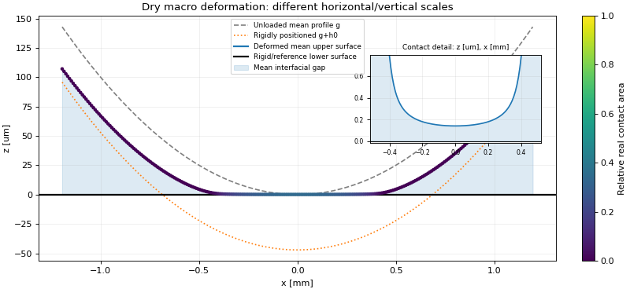
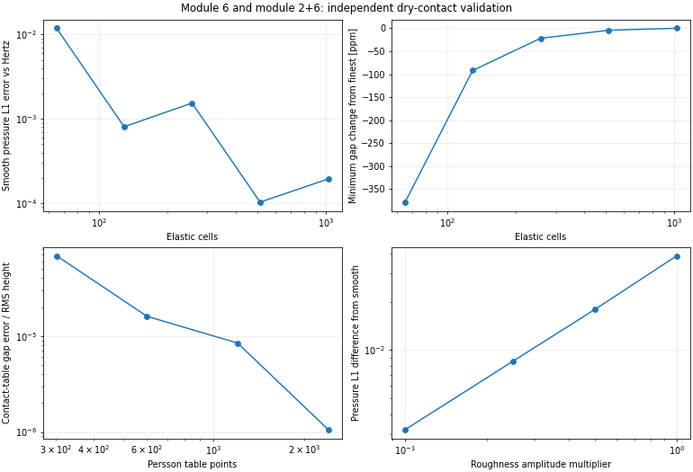

# 模块 6 与模块 2＋6：宏观弹性变形及粗糙干接触

此报告记录独立干接触模块。后续新增的流体—接触—形变耦合见[混合润滑报告](../mixed_lubrication/README.md)，通过独立RUN_MIXED_FRICTION任务使用。

2026-10-30。在 `2c46b73` 基础上增加独立宏观弹性响应与载荷控制的干接触求解，完成给定压力的位移检查、光滑 Hertz 检查，以及 Persson 微观接触与宏观变形的耦合检验。没有改写现有泄漏、气体或剪切计算；完整流体—结构耦合仍未启用。



图中虚线是零载荷参考轮廓，点线是只做刚体平移的轮廓，实线是加上弹性响应后的平均表面。点线允许与平面相交：它是用于分解位移的虚拟中间轮廓，不是最终表面穿透。颜色表示真实接触面积比；平均间隙大于零时仍可存在粗糙峰接触。小图单独放大约 0.14 μm 的中心间隙。大图横向为 mm、纵向为 μm，不能按像素推断斜率；另提供[真实纵横比例图](rough_geometry_true_scale.png)。

报告中的较大图采用70—80 dpi预览以便在线查看；日常程序仍输出170 dpi几何图，CSV中的真实尺寸不变。

## 模块职责与实现范围

| 文件 | 职责 |
| --- | --- |
| `macroscopic.py` | 独立的平面应变半空间弹性算子、Hertz 参考、光滑接触主动集求解 |
| `dry_contact.py` | 模块 2＋6 耦合：接触查表适配、平均间隙与整体间距的 Newton 求解 |
| `macro_output.py` | 参数检查、独立任务入口、几何与诊断输出 |
| `scripts/validate_macroscopic_contact.py` | 独立积分、解析解、网格／域／查表／参考长度／尺度检验 |

第一版限定一维线接触、抛物线局部圆柱轮廓、线弹性半空间、非黏附、给定线载荷。没有有限厚度或背衬，没有完整 O-ring／塞子三维结构，没有球接触，没有流体压力、温度或摩擦反馈。模块 6 的弹性算子可独立接收任意单元压力向量；本次日常干接触入口先支持圆柱—平面。

## 方程与位移参考

半空间相对响应采用

\[
u(x)=\frac{2}{\pi E^*}\int p(s)\ln\frac{L_{ref}}{|x-s|}\,ds.
\]

上部弹性圆柱与下部刚性平面时，E*=E/(1−ν²)。输入合并 E* 并选择 `relative_only` 时，结果仅表示相对响应，显示的上表面是等效轮廓，不冒充两侧各自真实位移。

二维线载荷的绝对位移存在参考常数。默认 Lref 为全计算域长度，允许选择不小于全域长度的其他参考。将 Lref 乘 k，u 增加常数 `2 W' ln(k)/(π E*)`，刚体间距 h0 减少同一常数，压力与间隙保持不变。因此 h0 和绝对位移不能脱离参考长度当作唯一物理压入深度。

采用均匀压力单元和单元中心配点，单元内压力为常数；对数核在整个源单元上准确积分，包括对角自身奇异项。没有将奇异点替换为任意截断距离。核矩阵对称，位移是非局部响应。

粗糙干接触满足

\[
\begin{aligned}
g(x)&=x^2/(2R),\\
h(x)&=h_0+g(x)+u(x),\\
p_c(x)&=\mathcal P_{Persson}(h(x)),\\
\Delta x\sum_i p_{c,i}&=W'.
\end{aligned}
\]

W' 为 N/m 线载荷。这里 h 是唯一的平均界面间隙，Persson 平均间隙关系直接约束同一个 h，不再额外叠加一层“粗糙间隙”。宏观轮廓与 PSD 应当分别描述平均形状及其残余粗糙度；程序沿用用户 PSD，不自动切谱或滤波来制造尺度分界。

光滑分支采用 p≥0、h≥0、ph=0 的载荷约束接触主动集。粗糙分支以全部单元的 h 和一个 h0 为未知量，用解析查表导数、Newton 方程和带表域保护的回溯搜索求解。没有使用参考压力减流体压力的局部卸载公式。

## 接触数据库与远场处理

宏观干接触使用自己的压力—间隙数据库，与原泄漏数据库分开配置。默认 1201 点，将约三分之一节点分给极低压尾部，其余分给工作压力范围。log(p) 对平均间隙做保形插值；求解后直接调用原能量积分重新计算平均间隙，单独报告查表误差。超过高压端明确报错，不能靠外推获得更大的局部压力。

当远场 h 超过数据库最大间隙时，将小于 p_min 的尾压近似为零，并显式报告 `p_min × 域长度` 的固定间隙遗漏载荷上界。这个上界不是完整耦合解的严格误差界。没有设置正压力地板。参数检查要求该界除以目标载荷小于所选求解容差。默认 p_min=1e-100 Pa；默认示例全部压力仍在表内，没有触发尾部截断。减小粗糙度的形式极限检验会触发截断，记录了对应单元数和上界。

## 默认示例结果

E=3 MPa，ν=0.5，E*=4 MPa；截面曲率半径 R=5 mm，线载荷 W'=100 N/m，域为 ±1.2 mm，257 个单元。R 不是此前 9.525 mm 的塞子周向半径。PSD 沿用仓库文件，γ=0.4。

| 结果 | 数值 |
| --- | ---: |
| 光滑 Hertz 参考半宽 | 0.398942 mm |
| 光滑 Hertz 参考峰值压力 | 0.159577 MPa |
| 粗糙耦合峰值压力 | 0.157798 MPa |
| 最小平均间隙 | 0.140348 μm |
| 载荷相对残差 | 4.31e-13 |
| 几何方程归一化残差 | 1.44e-12 |
| 接触查表最大间隙偏差 | 8.00e-12 m |
| 边界压力／峰值压力 | 1.70e-50 |

平均表面、压力、位移及接触面积数据在 [rough_geometry.csv](rough_geometry.csv)，诊断及完整输入快照在 [rough_diagnostics.json](rough_diagnostics.json)。图像是平均截面，不根据 PSD 虚构相位或单个粗糙峰形状。压力、间隙与位移的并列图见 [rough_response.png](rough_response.png)。

## 独立验证与收敛



16 项数值验证通过；检查标准及实际值见 [summary.json](summary.json)，回归测试记录见 [verification.json](verification.json)。

| 检验 | 本次结果 |
| --- | --- |
| 给定非均匀压力的位移 | 对数核与独立自适应积分最大相对差约 4.22e-15 |
| 光滑 Hertz 压力 | 1025 单元的单元平均压力 L1 相对差约 0.0194% |
| 光滑 Hertz 间隙轮廓 | 最大误差／Hertz 几何尺度约 0.00575% |
| 粗糙接触空间加密 | 257→1025 单元，峰压变化约 0.00126%，最小间隙变化约 0.00218% |
| 域加宽 | 半域从 2a→4a，保持近似单元尺寸，最小间隙变化约 0.0000137% |
| 独立查表加密 | 301／601／1201／2401 点；默认表与更细表的峰压差远小于空间误差 |
| 位移参考变更 | Lref 加倍，压力变化／峰值约 2.41e-12，间隙变化／RMS 约 3.01e-12；h0 变化符合解析常数 |
| 模量与线载荷同时乘 0.6 | 间隙保持一致，压力按 0.6 缩放 |
| 粗糙度减小 | RMS 振幅乘 1、0.5、0.25、0.1，压力对光滑数值解的 L1 差从约 3.87% 降到 0.320% |

Hertz 接触边缘会跨越不同网格位置，因此压力 L1 误差并非每一级加密都单调下降；没有据此宣称严格误差界。极小粗糙度的中心间隙可低于连续介质的物理尺度，该组只检验形式极限，不当作真实材料的纳米间隙预测。空间网格、接触查表、域宽、位移参考和求解残差分别检查，不互相替代。

数据文件分别为 [给定压力](given_pressure_displacement.csv)、[光滑网格](smooth_convergence.csv)、[粗糙网格](rough_convergence.csv)、[域宽](domain_convergence.csv)、[查表](table_convergence.csv)、[粗糙度极限](roughness_to_smooth.csv)。

## 日常使用

在 main.py 设置：

```python
RUN_MACRO_CONTACT = True
RUN_LEAKAGE = False
RUN_MIXED_FRICTION = False
COMPUTE_PRESSURE_FLOW = False
COMPUTE_SHEAR_FLOW = False
```

RUN_CONTACT 可以保持默认；宏观任务自行建立必需的模块 2 数据库。该任务不需要导出微观 PDF。流体耦合尚未完成，同时开启流体任务会在生成结果前明确报错。

parameters.py 的 CASE.macro_contact 选择模型与工况：

```python
'geometry': 'cylinder_plane',
'geometry_parameters': {'cylinder_plane': {'radius_m': 5e-3}},
'elastic_model': 'half_space_plane_strain',
'body_representation': 'upper_elastic_lower_rigid', # 或 relative_only
'contact_model': 'persson',                        # 或 smooth
'line_load_n_m': 100.,
'domain_half_width_m': 1.2e-3,
'reference_length_m': None,
```

NUMERICS.macro_contact 控制空间网格、求解容差、边界压力检查及接触查表范围。输出目录要换成新的路径，例如 `results/macro_contact`；原泄漏默认开关和参数仍保留。

运行 `python main.py` 得到：

| 文件 | 内容 |
| --- | --- |
| macro_geometry.csv | 初始轮廓、刚体平移后轮廓、相对弹性位移、最终平均表面、平均间隙、压力、面积比及局部误差 |
| macro_contact_table.csv | 粗糙分支使用的独立压力—间隙—面积数据库 |
| macro_diagnostics.json | 模型范围、材料、位移参考、载荷／几何／查表误差、尾部界限、输入快照 |
| macro_geometry.png | 纵向放大并带接触区细节的变形图 |
| macro_geometry_true_scale.png | 横纵坐标均以 mm 表示的真实比例图 |
| macro_response.png | 压力、平均间隙和位移曲线 |

图像纵向放大只影响显示，CSV 全部使用真实 SI 尺寸。`relative_only` 模式下显示的上表面明确标为等效轮廓。

独立复现本报告无需原 Fortran 包：

```bash
python scripts/validate_macroscopic_contact.py --output /tmp/macro_validation
PYTHONPATH=src python -m unittest discover -s tests -v
```

输出目录必须不存在，绘图需要 matplotlib。参考压力位移检查、Hertz 验证与粗糙耦合检查均由实际运行产生；没有把新的宏观结果当成完整混合润滑或整个密封结构的验证。
