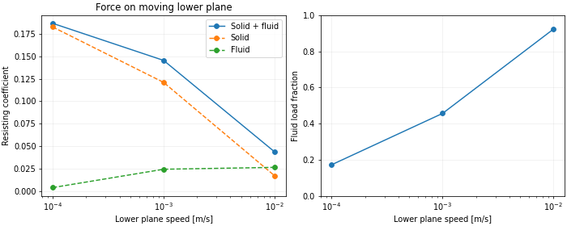
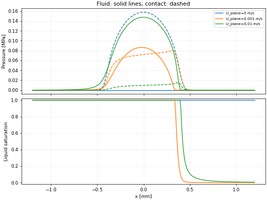
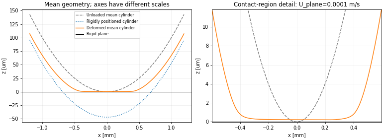

# 混合润滑：流体、接触、宏观形变与摩擦

这一任务在已有模块上增加独立耦合求解器，不改写原泄漏程序。当前范围是一维稳态、线弹性圆柱—平面、各向同性单侧粗糙、恒黏度牛顿液体、无滑移及连通导流分支。忽略黏弹滞后、热效应和切向弹性变形。







## 本次验证结果

演示参数：E=3MPa、nu=0.5、eta=0.1Pa·s、圆柱曲率半径5mm、线载荷100N/m、仓库PSD、界面剪切强度0.1MPa、剪切间隙下限1nm。**剪切强度与下限均为演示假设，不是用户实验标定；此工况不等同于之前0.414MPa密封泄漏复算。**

| 下平面速度 m/s | 流体承载比例 | 最小平均间隙 um | 模型合计摩擦系数 |
| --- | --- | --- | --- |
| 0 | 0 | 0.1403 | 不求静摩擦 |
| 0.0001 | 17.20% | 0.2151 | 0.18657 |
| 0.001 | 45.61% | 0.3543 | 0.14539 |
| 0.01 | 92.29% | 1.1689 | 0.04379 |

0.01m/s时，下平面固体阻力1.7247N/m、流体阻力2.6547N/m，合计4.3793N/m。示例宽度10mm时合计0.043793N。反向速度得到镜像压力、相反的带符号摩擦力及相同的阻力系数。这里只扫描了这段速度范围，没有据此声称完整Stribeck曲线已经覆盖。

148项自动测试及11项独立审计检查通过。257→513单元使摩擦系数变化0.574%、通量0.566%；计算域半宽扩大50%使摩擦系数变化0.0884%；输运样本由83增至163使其变化0.0116%。独立刚性圆柱空化积分参考，在513单元时通量误差0.0522%、压力L1误差0.1026%。尺度积分步长减半使两个抽查压力的逆矩变化0.36%及0.40%。这些是本示例的数值检查，不是任意工况精度保证。

0.01m/s下，剪切下限取0.5/1/2nm时，摩擦系数分别约0.04997/0.04379/0.03986；对应法向解完全相同。这个变化明显大于上述网格误差，不能把演示下限隐藏为数值常数。

[工况CSV](example_cases.csv)、[0.01m/s完整空间剖面](example_profile.csv)、[实际输运表](example_transport_table.csv)、[诊断与输入](example_diagnostics.json)、[收敛与敏感性汇总](summary.json)、[测试记录](verification.json)。原始完整多速度压力／间隙／空化图也可由程序输出，在线预览图采用较低dpi，CSV保留完整数值。

## 使用

在main.py开启`RUN_MIXED_FRICTION`，关闭`RUN_LEAKAGE`、`RUN_MACRO_CONTACT`、`RUN_CONTACT_FRICTION`。所需接触、压力／剪切流动及摩擦自动计算，不要求额外打开COMPUTE开关。

parameters.py按研究对象分组：

| 参数块 | 用途 |
| --- | --- |
| `material`、`psd`、`options` | 共用材料、仓库PSD和Persson积分设置；本任务要求conservative尺度积分 |
| `macro_contact` | 上部弹性圆柱曲率、线载荷、计算域、半空间变形及接触查表 |
| `interface` | 恒定牛顿黏度，无滑移 |
| `mixed_friction` | 下平面速度扫描、粗糙侧、两个储液边界压力、空化及耦合求解精度 |
| `fluid_friction` | shear friction factors模型及液体剪切间隙下限 |
| `contact_friction` | 实验界面剪切强度模型、温度、可选横向宽度 |

剪切强度默认None，必须填写实验值。示例验证明确使用演示值0.1MPa，不是实验拟合。`contact_friction.relative_velocities_m_s`只用于独立干摩擦；混合任务速度在mixed_friction中设置。输出请使用新的空目录。

原leakage的参考压力几何、局部卸载、gas、spc平台和physical_zero选择器不参与这个独立任务。原泄漏结果不因此改为宏观耦合结果。

## 坐标、压力和法向耦合

坐标系随上部圆柱移动，圆柱速度为0，下部刚性平面速度为给定的`lower_wall_velocities_m_s`。正速度沿+x，因此接触界面的带符号相对速度`U_upper-U_lower=-U_plane`。这也是输出通量的参考系，不是实验室系下随意固定一条正在移动的圆柱轮廓。

宏观轮廓为`g=x²/(2R)`，未知量包括平均间隙h、流体压力pf、液体充满比例theta及刚体偏移h0：

```text
h = h0 + g + C(pc + pf)
pc = PerssonContactLaw(h)
integral (pc + pf) dx = prescribed line load W' [N/m]
```

C复用模块6的非局部半空间柔度。宏观间隙与Persson平均间隙是同一个量，不重复叠加。pc和pf按本平均有效应力模型作承载分解；不会再把流体承载乘一次非接触面积比。没有求有限厚度橡胶块或完整O-ring的FEM变形。

二维位移参考长度会改变绝对位移和h0，不改变压力与平均间隙。圆柱R是接触截面曲率半径，不是塞子用于换算周向宽度的整体半径。PSD仍表示平均轮廓以外的粗糙度，需要满足尺度分离假设。

## 流动和守恒空化

满液通量写为：

```text
q = -K(h)/(12 eta) * dpf/dx + S(h; U0,U1)
S = (U0+U1) h/2 + sign*(U1-U0) Ls/2
Ls = h / [1 + 2 h max(h-hc,0)/(3 hrms²)]
```

粗糙上壁sign=+1，粗糙下壁sign=-1。hc来自接触面积比达到设定渗流阈值时的平均间隙。K复用已有保守PDF—Bruggeman导流模型。这里的剪切流量因子和压力流量因子只描述输运，不代替壁面剪切力。

零表压既为储液参考压力，也为空化压力；允许储液边界给非负表压。流入储液边界满液，内部满足：

```text
pf >= 0
0 <= theta <= 1
pf*(1-theta) = 0
q = -K/(12 eta) * dpf/dx + theta*S
dq/dx = 0
```

这属于压力—充满比例形式的守恒空化离散。使用有限体积通量、调和平均导流和迎风充满比例；压力与充满比例通过同一个分段变量联立求解。没有先求负压再把它裁成0。

耦合采用缩放后的半光滑Newton及线搜索；必要时插入逐步增加速度／边界压力的初始化工况。中间工况不改变最终指定参数。零速、零边界压力直接恢复同一份干接触解，不设置人为小速度。

首版仅求连通导流分支。遇到物理零导流和封闭液袋会报错，不设置导流地板或spc平台。封闭液袋需要单独的流体体积、压力和历史状态模型。

## Shear friction factors

采用原始2026年9月压缩包中的无滑移、各向同性插值形式。记I为按名义面积计的逆间隙矩近似，sigma=hrms，delta=max(h-hc,0)：

```text
phi_f  = h*I
phi_fs = 3*h*I / [1 + 2*delta*h²*I/sigma²]
phi_fp = h*delta / (h² + 1.5*sigma²)
```

h<=hc时，phi_fp=0，phi_fs=3hI。光滑极限单独恢复(1,0,1)。这里沿用Persson插值框架；这些近似与现有流量闭合组合使用，不代表已从同一个微观几何精确推导出全部系数。

在光滑下壁／粗糙上壁的配置，流体对壁面沿+x的平均牵引为：

```text
t_lower =  theta*eta*(U1-U0)*(phi_f+phi_fs)/h - phi_fp*h/2*dpf/dx
t_upper = -theta*eta*(U1-U0)*(phi_f+phi_fs)/h - (2-phi_fp)*h/2*dpf/dx
```

下壁粗糙时，交换两个压力项中的phi_fp与2-phi_fp。两侧流体牵引之和为`-h*dpf/dx`，不应要求它们在有压力梯度时互为相反数。粗糙壁面的结果包含该平均闭合所分配的微观压力形状阻力；宏观曲面压力的水平投影另计，不能重复添加微观形状阻力。

主摩擦系数针对正在运动的下平面：它宏观上平坦，因此不另加宏观斜率压力力。上壁面的宏观流体压力投影独立输出；没有把它与未完整计算的上壁固体法向投影合成所谓“上圆柱总阻力”。

空化区将运动剪切乘theta，是明确的均匀润湿液条近似。质量守恒并不能同时证明这一摩擦闭合准确；微观气泡／液条形态和边界膜应力仍未求解。

## 逆间隙矩与纳米下限

当前选择原程序`iuinverse=1`这一类尺度近似：

```text
I ≈ sum [-Delta A / u1]，仅保留u1 >= minimum_shear_gap_m的尺度样本。
```

使用已有conservative尺度面积权重和u1，不是直接对展宽后的P(u)积分P(u)/u。当前反射高斯近似在u=0处具有正密度，无下限的逆矩会发散，不能靠增加积分点把它“算准”。

`minimum_shear_gap_m=1nm`只是演示假设，须根据研究体系调整。它与PDF的`pdf_min_u1_m`数值截断独立，也不是滑移长度或给宏观间隙加一层1nm膜。它不改变法向解、导流或真实接触面积。下限以下的液体／边界膜剪切没有计入，也没有转移到固体摩擦；报告的总力是已建模两项之和。

输运表同时输出无额外剪切下限、半下限、双下限的逆矩信息和被排除的概率。敏感性扫描使用同一法向解，以免把膜厚改变与剪切积分改变混为一谈。

原程序部分路径还会将phi_f钳制到至少1，按压力索引线性外推，或在空化处按压力阈值删除全部运动剪切。这些补丁未移植。当前的结果不能因此声称与原版完整混合润滑程序逐项相同。

## 大间隙与查表范围

近接触区域使用已有保守PDF导流和尺度逆矩。很低接触压力下，有限尺度PDF不能可靠描述远场，因此在h从3hrms到4hrms之间用smoothstep显式过渡到二阶各向同性渐近式：

```text
K = h³ - 1.5*hrms²*h
phi_f = 1 + (hrms/h)²
```

这是一项明确的闭合选择，不是无条件准确公式，也不是延长接触表的压力外推。它与原包某些路径使用的系数和跳转不同。导流表记录切换权重及原始近接触模型结果，以便后续替换或研究。

原PDF遗漏概率的局部导流上界仍输出，但不把它解释为非线性耦合后压力、膜厚或摩擦的全局上下界。数值收敛与这些模型不确定性分别报告。

## 输出与验证

| 文件 | 内容 |
| --- | --- |
| `mixed_cases.csv` | 每个速度的接触／流体载荷、接触面积、最小平均间隙、流量、固体／流体力、合计摩擦及残差 |
| `mixed_profile_*.csv` | 形变前后平均轮廓、位移、压力、面积比、充满比例、左右面通量、摩擦因子和壁面牵引 |
| `mixed_transport_table.csv` | 压力／剪切流量因子、三个shear friction factors、遗漏概率、大间隙切换及剪切下限敏感性 |
| `mixed_contact_table.csv` | 实际使用的有界Persson接触表 |
| `mixed_diagnostics.json` | 方程约定、参数快照、物理假设、限制与工况汇总 |
| PNG图 | 压力、膜厚／形变、空化、承载分担和固体／流体摩擦 |

力默认N/m。填写横向宽度后另输出总力N，流量从m²/s乘宽度得到m³/s。只有确认流向长度／横向宽度及环形近似适用时，才将宽度设置为2πR。

独立验证包含光滑平板Poiseuille/Couette解、刚性圆柱守恒空化的积分解、零速干接触极限、载荷和几何闭合、速度反向、位移参考不变性、空间／计算域／输运表收敛及剪切下限敏感性。具体数值见本目录CSV、summary.json和verification.json；示例为编程验证，不是用户实验预测。

原Fortran核对使用第一次上传的压缩包，SHA256为`ae0dfddc8a5b8a8e5058d8cbe74f67fd00102bc76df42f6c734bfd41cea2b968`，其中源文件为`AI.ContactMechanics.14.09.2026.f90`。12组提取公式的实际编译对照最大相对差为2.32e-16；它验证三个插值表达式，不验证逆矩闭合、空化或完整耦合求解器。[原始核对数据](../../tests/data/fortran_shear_friction.json)。

复核命令：

```bash
PYTHONPATH=src python -m unittest discover -s tests -v
PYTHONPATH=src python scripts/verify_shear_friction_reference.py --archive ORIGINAL.zip --compiler gfortran --output NEW_REFERENCE.json
PYTHONPATH=src python scripts/validate_mixed_lubrication.py --run-directory results/mixed --output results/mixed_audit
```

审计脚本只复用已完成运行的原始输运样本，重建接触表并验证PSD哈希；会重新求不同网格和计算域的耦合解，不是对同一份结果换标签。
