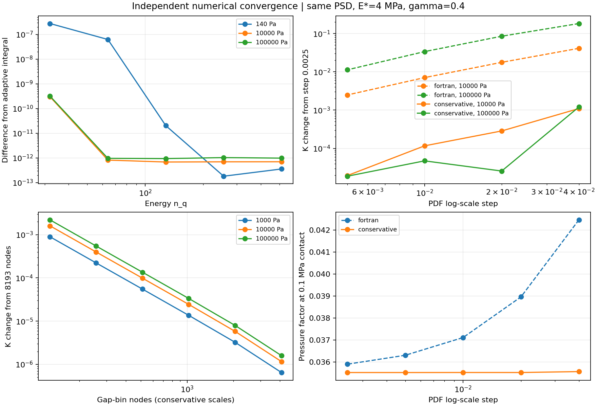

# 独立数值收敛与物理极限检查

2026-10-30。在 `3bfa5f9`（包含 `3caf351`）基础上，分别检查能量积分、PDF 尺度积分、间隙分箱和有效介质求根，不再以贴合 Fortran 输出作为准确性标准。原 Fortran 复算方法仍保留，未改写已有的泄漏／剪切／气体模块结构。

发现的主要问题是：**间隙分箱收敛不等于 PDF 尺度积分收敛。**旧路径在默认步长 0.01 下仍有可见的尺度偏差。新增准确谱积分、精确面积差加权的 `conservative` 路径后，在本次正常导通工况中显著改善；但近渗流的遗漏概率和 PDF 模型误差仍不能靠加密消除。



## 工况与检查范围

沿用仓库 PSD，SHA-256 为 `c5e41d8e8b1bd8f15b222620794c4a3268cafdc52a21ffae4cb3579967c0e884`。E=3 MPa，ν=0.5，E*=4 MPa，γ=0.4，常数牛顿黏度 0.1 Pa·s，无滑移。独立尺度矩阵共 50 个状态：两种算法 × 五个尺度步长 × 五个接触压力（1、10、100 kPa，以及渗流压力的 0.98 和 1.01 倍）。这里的压力是接触压力，不是流体入口压力；不是 FEM 0.414 MPa 泄漏工况。

- 能量积分：n_q=32、64、128、256、512；另用按 PSD 节点分段的自适应积分作参考，检查 140、10000、100000 Pa。
- PDF 尺度步长：0.04、0.02、0.01、0.005、0.0025。导流分箱单独要求相邻粗细比较小于 1e-4，避免混淆两种网格误差。
- 间隙分箱：129 至 8193 节点，在新路径下单独比较。
- 截断敏感性：u1 下限分别为 1e-11、1e-12、1e-13 m。
- 14 项独立物理／解析检查，以及覆盖液体、ballistic、滑移、剪切、空间泄漏和历史 Fortran 样本的回归测试。

完整 CSV、检查容差和源码哈希均放在本目录；最细网格也是数值结果，不视为严格真值或全参数误差上界。矩阵及物理检查实际运行约 139 秒（测试同时运行，时间不可直接当作性能比较）。

## 修改了什么

**新增 `pdf_scale_method='conservative'`。**PSD 区间矩按原始分段幂律准确积分，条件载荷 p/A 下的平均间隙使用已有的消奇异能量积分；尺度区间权重直接取准确的面积差 A_left−A_right。面积截断位置通过求根确定，包括最后一个不足整步长的区间。u1 仍按同一物理关系计算，使用 log(q) 网格上的二阶导数；遇到 u1 下限仍停止，不人为补尾、不调间隙、不归一化 PDF。

`pdf_scale_method='fortran'` 保留原右矩形谱积分、中心差分和尺度截断约定，继续用于已有历史参考。两条路径共用接触模型、反射高斯近似、展宽关系及遗漏概率导流上下界政策。新方案改变的是这些近似方程的离散与积分方式，不代表反射高斯近似已经得到实验验证。

新增批量准确 PSD 区间矩，避免反复逐个积分，也不通过两个大前缀积分相减计算微小残余。局部积分缓存设有数量上限；新路径的同一压力尺度结果可复用，避免流动分箱加密时重复计算。

**修正渗流附近求根残差的相消。**原残差先累计接近 1 的项再减 1，可能打印零残差但根仍有相对误差。新残差围绕有限／无限导流阈值的概率余量计算，继续使用带括区间的 Brent 求根，不加任意 K 下限，不改原阈值舍入带。

## 定量结果

### PDF 尺度积分

0.1 MPa 接触压力下的压力因子：

| PDF 步长 | fortran 路径 φp | conservative 路径 φp |
| ---: | ---: | ---: |
| 0.04 | 0.04245539 | 0.03556316 |
| 0.02 | 0.03895812 | 0.03552124 |
| 0.01 | 0.03711059 | 0.03552201 |
| 0.005 | 0.03630459 | 0.03551967 |
| 0.0025 | 0.03589955 | 0.03552033 |

相对各自步长 0.0025 的 K，默认步长 0.01 的变化量：

| 接触压力 | fortran 路径 | conservative 路径 |
| ---: | ---: | ---: |
| 1 kPa | −0.00453% | −0.00628% |
| 10 kPa | +0.7057% | +0.01164% |
| 100 kPa | +3.3734% | +0.00471% |

新路径没有在每个压力、每个步长上都单调接近极限，低压点也不是每一级都更准确；PSD 折点、u1 导数和截断边界仍会带来细小变化。本次三组正常导通状态的默认步长到最细步长变化均小于 0.012%，通过预先设置的 0.2% 检查标准。不得将此表推广为任意 PSD 或渗流附近的统一精度保证。

在相同默认步长 0.01 下，100 kPa 的新 K 比旧 K 约低 4.28%。这不是为贴合 Fortran 而校准的系数，而是改变离散后得到的结果；需要历史复算时选择 `fortran`。参见 [完整尺度数据](scale_convergence.csv)。

### 其他数值与物理检查

- **平均间隙积分已稳定。**n_q=256 相对使用同一能量核的独立自适应积分，在三点的最大差约 1.04e-12；这只是外层积分比较。能量核自身另与直接自适应积分比较，15 个样本最大相对差约 1.46e-10，不把前者当作整个模型的严格误差上界。
- **导流分箱误差较小。**新路径 2049 与 8193 节点的 K 最大相对变化约 0.00080%，远小于旧 PDF 尺度偏差。
- **概率闭合。**新路径的已解析概率加显式遗漏概率等于准确的非接触概率，在浮点精度内闭合；面积仍由原模型决定，未将遗漏质量并入真实接触。
- **近渗流解析根。**在 d=2、单一有限导流相与零导流相混合时，解析解为 K=k(w−z)。例如 z=0.5−1e-14，原求解相对差约 0.546%，新求解降至浮点舍入量级；跨 k=1e-200 至 1e200 的矩阵最大差约 4.22e-14。无限导流相阈值附近也通过独立解析检查。
- **物理极限。**平行板 Poiseuille、压差反向、正压力耗散、剪切幅值范围、光滑极限、分支连续性、共同壁速平移均通过。给定窄高斯间隙的有效介质结果趋于 φp=1−1.5(RMS/h)² 的二阶极限；这是闭合积分的检查，不证明真实接触 PDF 的大间隙行为完全准确。
- **空间运动流动。**线性阻力和线性带液源的制造解可解析积分；三组空间网格的通量最大相对差约 8.54e-9，面通量不守恒量低于 2.27e-13。

检查详情见 [physical_limits.json](physical_limits.json)、[summary.json](summary.json)；全部回归结果见 [verification.json](verification.json)。

## 仍然存在的限制

1. **PDF 第一矩不等于能量平均间隙。**100 kPa 新路径最细步长下差约 +1.89%，近渗流样本约 −3.45%。这类偏差不能通过归一化或缩放间隙掩盖。
2. **遗漏概率不是数值舍入。**100 kPa 默认新路径仍遗漏约 1.45% 的名义面积概率；对应 K 上界约比默认 K 高 42%。上下界表示遗漏相导流未知，不是统计置信区间。
3. **近渗流不宣称充分收敛。**本例渗流压力约 197339 Pa。在其 0.98 倍，默认 K=0、上界非零，状态仍为 `unresolved_connectivity`；上界对尺度步长及 u1 截断敏感。切换截断还可能改变导通判断，不能仅看默认值零就当作已证明物理堵塞。1.01 倍样本上下界均为零。
4. **未自动证明任意工况的全部精度。**日常 `quadrature_relative_difference` 只检查间隙分箱，不包括 PDF 尺度、能量积分、空间网格或模型误差；`flow_diagnostics.json` 已明确记录算法、尺度步长与这个范围。新工况仍需独立减半 PDF 步长。
5. 没有引入人为大间隙拼接、额外经验参数或修改渗流政策；非牛顿、双侧粗糙和完整混合摩擦不在本次修改范围。

## 使用与复现

日常 `parameters.py` 的 `NUMERICS['options']` 已改为：

```python
'pdf_scale_method': 'conservative',  # 推荐的新尺度积分
'pdf_log_step': 0.01,
```

历史复算设为 `'fortran'`。为兼容已有直接 API 和旧 JSON，省略这个新字段仍使用 `fortran`；新 API 计算可显式传入 `PerssonModel(..., pdf_scale_method='conservative')`。其他参数和 main 开关用法不变。

在仓库根目录运行独立审计（不需要原 Fortran ZIP）：

```bash
python scripts/audit_numerical_convergence.py --output /tmp/my_numerical_audit
PYTHONPATH=src python -m unittest discover -s tests -v
```

输出目录必须不存在；图像需要 matplotlib。报告的外层积分、尺度积分、分箱积分和物理检查均有独立数据文件。未修改历史 Fortran 参考采样来适配新算法；历史默认 API 继续通过原参考回归。
