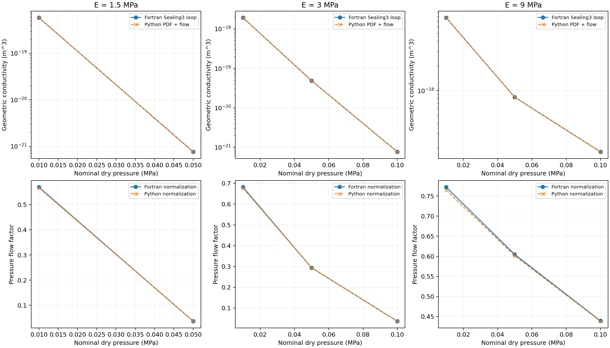
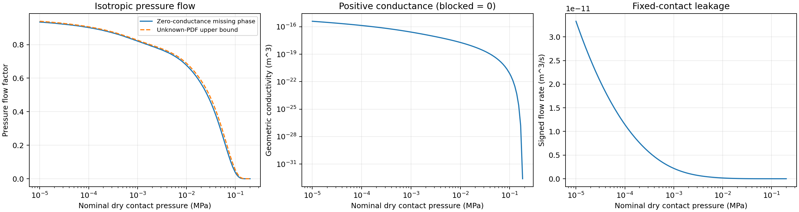

# 模块3与模块4第一阶段：界面规律、压力流动、泄漏算例

保留两个独立模块：interface.py 定义局部流体及壁面规律，flow.py 定义粗糙接触的有效压力流动。applications.py 只组合固定接触状态下的均匀密封泄漏。没有合并或跳过原有模块划分。

## 运行与参数

日常仍运行 `python main.py`。默认 `COMPUTE_PRESSURE_FLOW=True`；`RUN_LEAKAGE=True` 时额外输出泄漏结果，自动调用接触和压力流动。关闭 `COMPUTE_GAP_PDF` 仅停止PDF文件导出；流动内部仍按需计算PDF。只计算干接触时关闭压力流动和泄漏。

parameters.py 中新增：

```python
'interface': {
    'rheology': 'newtonian',
    'wall_slip': 'no_slip',
    'viscosity_pa_s': 0.1,
},
'pressure_flow': {
    'closure': 'fortran_isotropic_bruggeman',
    'gap_points': 2049,
    'quadrature_relative_tolerance': 0.002,
    'max_gap_refinements': 2,
    'unresolved_flow_policy': 'zero_conductance_with_upper_bound',
},
'leakage': {
    'inlet_pressure_pa': 1e4,
    'outlet_pressure_pa': 0.,
    'seal_length_m': 1e-3,
    'seal_width_m': 1e-2,
},
```

黏度0.1 Pa·s取自原Fortran输入；尺寸和压差仅为演示。所有单位SI。泄漏分组不重复给黏度，避免两个来源不一致。渗流面积沿用 options.critical_relative_contact_area=0.42。压力仍是原 contact_pressure 或 pressures_pa 给定的**干接触名义压力**；不会自动减去流体压力。

## 公式与模块职责

模块3提供无滑移恒黏度规律：

\[
\sigma_\mathrm{local}(s)=\frac{s^3}{12\eta},\qquad
J=-\sigma_\mathrm{local}\nabla p+\frac{v_1+v_2}{2}s.
\]

Couette项只是局部壁面规律；均质化剪切流动因子尚未实现。复杂流变、壁面滑移和各向异性选择均不静默降级。

模块4使用原 Sealing3 的各向同性直接PDF闭合，几何导流系数K的单位为m³：

\[
\left\langle\frac{s^3-K}{s^3+(d-1)K}\right\rangle=0,
\quad d=2+\left[\frac{1}{1-a_c}-2\right]\min(a/a_c,1).
\]

这里 a 是接触模型的 relative contact area，a_c=0.42。液压导流系数 sigma_eff=K/(12eta)，压力流动因子 phi_p=K/h³。根在log(K)上用括区间求解，替代原程序的缓慢松弛迭代；阻断状态直接给K=0，不人为设一个正数下限。概率积分使用解析CDF差，不靠点值密度的梯形积分。

原程序的 s³−u_end³ 在最低截断间隙附近可能出现负局部值。新局部流体规律保持非负的s³；本次导通工况该差异低于对照精度，不影响下面的符合情况。

泄漏算例使用 Q=(W/L) sigma_eff DeltaP，只描述接触状态沿密封方向均匀且固定的情形。**没有求解流体承载反馈，也没有求圆柱压力和弹性变形。**

## PDF遗漏概率与阻断

原程序 AreaContact=1−integral(Pdu)，把PDF截断缺口也当作零导流。新程序保留这个导流约定，但不把缺口称为新增真实接触。

- 默认/下界：真实接触和未表示的非接触概率都放入零导流相。
- 上界：真实接触保持零导流；未表示的非接触概率放入无限导流相。
- PDF不归一化，接触面积不修改；上下界只是在所选闭合和已解析PDF下对缺口处理的确定性界限，不是实验置信区间。
- `conducting`：默认闭合存在正导流；`blocked`：上下界都为零；`unresolved_connectivity`：下界零、上界非零，不能宣布真实流路已经阻断。

例如额外检查 p=0.195 MPa 时出现第三种状态。默认110点扫描没有恰好命中这个点，因此不能用压力表的采样密度推断阻断压力已精确定位。

## 原Fortran核心对照

从用户原始源码（SHA256 99d3b2e2c47a663ffe8b65bbdb7415db5eeebb434debd0ef404006600e861854）的 Sealing3 中抽取 **do 2277…2277 continue 的真实 P(u) 迭代循环，循环字节不变**，增加独立输入、初值和输出驱动，生成的 [Fortran验证驱动](flow_reference.f90) 保存在本目录。这不是重写一个声称等价的Fortran公式。

采用此前已完成的真实PSD分布输出，每组40000点；各向同性、无滑移、无附加边界膜，6000次迭代、feedback=0.9。原迭代的 s³−u_end³ 项保留。共9个导通工况完成实际编译运行，其中包含0.005尺度步长。E=1.5 MPa、p=0.1 MPa已超过阻断阈值，不用未收敛的正数迭代下限验证K=0，而以独立解析极限验证阻断。

同一份Fortran PDF分别交给原迭代和Python求根器，导流系数最大相对差低于3e-13，证明闭合求解一致。再使用Python自行计算PDF及CDF分箱，比较端到端结果：

| E (MPa) | p (MPa) | ln(zeta)步长 | 导流系数K相对差 | 各自平均间隙归一化后的phi_p相对差 |
| --- | --- | --- | --- | --- |
| 1.5 | 0.01 | 0.01 | 0.001202% | -0.4665% |
| 1.5 | 0.05 | 0.01 | -0.006065% | 0.5366% |
| 3 | 0.1 | 0.005 | -0.007445% | 0.2749% |
| 3 | 0.1 | 0.01 | -0.006065% | 0.5366% |
| 3 | 0.01 | 0.01 | 0.001759% | -0.6892% |
| 3 | 0.05 | 0.01 | -0.000608% | 0.0210% |
| 9 | 0.1 | 0.01 | 0.000421% | -0.2416% |
| 9 | 0.01 | 0.01 | 0.001907% | -0.9117% |
| 9 | 0.05 | 0.01 | 0.001390% | -0.5278% |



K最大相对差0.00745%，phi_p最大约0.912%。后者主要包含原有平均间隙积分差异经h³归一化后的放大；未调整间隙来消除差异。

**此处验证的是Sealing3的各向同性直接PDF有效介质核心，尚未验证完整iflag008所有功能。** 原程序的大间隙渐近切换、连续性修正、各向异性、边界膜及剪切相关分支未移植。当前统一使用直接PDF分支；h/hrms较大处与原程序完整流程可能不同，不能将以上有限工况误差推广为整个压力范围的Fortran复现精度。

完整数值、编译器、源码循环/驱动/二进制和输入输出哈希见 [fortran_comparison.json](fortran_comparison.json)。`tests/data/fortran_pressure_flow.json` 保存9组实际参考值，回归测试不要求本机安装Fortran。

## 110压力点演示

真实PSD，E=3 MPa、nu=0.5，gamma=0.4，10至200000 Pa共110点；eta=0.1 Pa·s，W=0.01 m、L=0.001 m、DeltaP=10000 Pa。



在参考压力100000 Pa：

- 平均间隙 h=2.73878865e-7 m；relative contact area≈0.22084731。
- K≈7.62383282e-22 m³；sigma_eff≈6.35319402e-22 m³/(Pa·s)。
- phi_p≈0.03711059；遗漏概率约0.01447262，缺口无限导流时phi_p上界≈0.05275881。
- 默认泄漏Q≈6.35319402e-17 m³/s；缺口处理上界≈9.03211159e-17 m³/s。

这组范围说明1.45%的遗漏概率也可能显著影响流动；不能只依据PDF曲线视觉接近便认定泄漏已经高精度验证。默认110点中109点导通、1点阻断；另在0.195 MPa验证了连通性不确定状态。

本目录附有 [压力流动表](example_pressure_flow_table.csv) 和 [泄漏表](example_leakage_table.csv)。工作目录另输出flow_diagnostics.json，保存界面参数、积分加密误差、闭合残差和概率记账。正导流系数图在对数轴上省略K=0的点，不以一个小正数伪造阻断值。

## 验证与复现

49项测试通过。新增独立检查包括平行板Poiseuille/Couette极限、两相有效介质解析解、阻断阈值、黏度反比缩放、缺失概率上下界、压差反向、零压差、PDF导出开关与内部计算独立，以及9组实际Fortran参考。110点整流程另检查闭合残差、加密误差、概率记账和流量上下界。

```bash
python -m unittest discover -s tests -v
python main.py
```

复现Fortran核心对照需另行提供原始源码、已完成的分布输出及编译器：

```bash
python scripts/verify_pressure_flow.py --source /path/to/AI.ContactMechanics.14.09.2026.f90 --matrix results/benchmark_matrix/accelerated_v2 --psd examples/data/roughness_psd.dat --output results/new_pressure_flow_reference --compiler gfortran
```

下一阶段可继续完成模块4的剪切流动因子，然后进入摩擦因子与混合摩擦；本阶段没有把这些尚未实现的量填成零。
